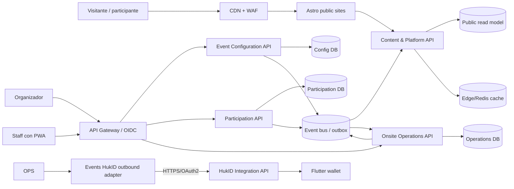

# Arquitectura de microservicios

## Objetivo de escalabilidad

El problema no se resuelve enviando más réplicas de una API monolítica. Las tres cargas tienen perfiles distintos:

| Carga | Patrón | Respuesta arquitectónica |
|---|---|---|
| Landing comercial, demo y sitios | muchas lecturas, picos por publicaciones/redes | Astro estático/SSR en edge, CDN y proyección pública cacheable |
| Inscripción/postulación | picos cortos de escrituras concurrentes y riesgo de sobrecupo | servicio Participation con idempotencia, rate limit y capacidad atómica por evento |
| Check-in | escrituras rápidas en sitio, conectividad irregular y QR duplicados | servicio Onsite con validación local/cacheada, cola durable y hechos append-only |

El objetivo inicial es soportar picos sin rediseño: las lecturas públicas no alcanzan las bases transaccionales, la inscripción no bloquea el backoffice y el check-in no depende de una llamada sincrónica al servicio de registro.

## Topología

Cada servicio posee su PostgreSQL lógico —base o schema/cluster aislado con roles y migraciones propias— y su outbox. Para el primer despliegue se permite un clúster PostgreSQL compartido físicamente, siempre que cada servicio use una base y credenciales distintas. No hay joins ni FKs entre bases.

## Servicios y ownership

### 1. Content & Platform Foundation

- Astro: landing comercial, landing demo, sitios institucionales y páginas de evento.
- CMS: páginas, bloques tipados, medios, navegación, tema y publicaciones.
- Public Read API: proyección inmutable de sitios, eventos publicados, agenda y estado de inscripción.
- Admin shell, design tokens y módulos React del CMS.
- Gateway/WAF, tenant directory, integración OIDC, resolución dominio→sitio, librería de autorización y plantilla CI/CD/telemetría.

La landing nunca consulta Event Configuration ni Participation durante una visita normal. El servicio consume `configuration.event.release_published.v1` y `participation.availability.changed.v1` y publica una proyección denormalizada, invalidada por tag/version. La disponibilidad es informativa; Participation toma la decisión final al registrar.

### 2. Event Configuration

- Organizaciones operativas, roles de organizador, sedes, eventos, tracks/programas, sesiones, ponentes y reglas de inscripción.
- Definiciones/versiones de formularios y bindings para registro/postulación.
- Módulos React de backoffice para configurar y publicar.

Es dueño de la intención editorial, no de registros ni asistencia. Al publicar crea un `publication_id` y emite un manifiesto completo; cada consumidor activa localmente la release sólo cuando materializa todos los artefactos requeridos.

### 3. Participation

- Registros individuales, cupos, waitlist, tickets QR, cancelaciones y confirmaciones.
- Emprendimientos, integrantes, postulaciones, anexos y snapshot de envío.
- Módulos React de gestión de participantes/postulaciones y formularios públicos de inscripción.

Consume el snapshot de configuración. Cada evento registrable tiene una fila local `registration_policy` y contador/cupo bajo bloqueo transaccional local; no consulta al servicio de eventos para decidir un cupo. Una misma `Idempotency-Key` devuelve siempre la misma respuesta. El QR es un JWS asimétrico con identificador opaco, audience, vigencia, scope y versión; Onsite valida criptográficamente los tickets recién emitidos y aplica una lista firmada de revocaciones.

### 4. Onsite Operations

- PWA React para check-in y búsqueda manual; el modo offline se difiere hasta tener protocolo de seguridad y conflicto aprobado.
- Hechos de entrada/salida/anulación append-only, deduplicación por ticket y dispositivo.
- Notificaciones, workers de outbox, dashboards de asistencia pseudonimizados, certificados y reporting purpose-bound.

No modifica registros. Construye proyecciones desde eventos de Participation y Event Configuration. Para certificado/export autorizado recibe un envelope cifrado y de retención limitada desde Participation; nunca hace SQL remoto. En conectividad normal confirma de inmediato. El modo offline se activa sólo en un incremento posterior con protocolo formal.

### 5. HukID

- Backend issuer/node en Go, API de integración, OID4VCI, status y firma.
- Wallet Flutter, claves del holder, recepción de ofertas, validación y presentación OID4VP.
- Consola mínima de issuer/integraciones.

HukID no pertenece a la plataforma de eventos. Onsite Operations emite el certificado PDF y, cuando corresponda, su propio worker/adaptador outbound llama a la Integration API de HukID idempotentemente y reconcilia por polling o webhook. El Equipo 5 posee la API y el producto HukID, no un consumer del bus de Events. No comparten autenticación interna, base de datos ni transacción.

## Contratos no negociables

1. **HTTP público:** el gateway aplica WAF, cuota por IP/evento, CAPTCHA o challenge adaptativo en registro y `Idempotency-Key` obligatorio.
2. **Eventos:** envelope único definido en `contracts/EVENT-CONTRACTS.md`: `message_id`, `domain_event_id`, `organization_id`, `business_event_id`, `topic`, `schema_version`, tiempos, actor, tracing, aggregate y data; entrega al menos una vez e inbox idempotente.
3. **Publicación:** `Event Configuration` es el único productor de snapshots publicados. Content y Participation los consumen, no los reconstruyen por llamadas encadenadas.
4. **Capacidad:** Participation es el único escritor de cupos/waitlist. Event Configuration sólo cambia reglas con una nueva release; una reducción de cupo por debajo de confirmados genera conflicto operativo, nunca cancelación silenciosa.
5. **Ticket:** Participation es el único emisor/revocador. Onsite valida JWS y revocación firmada/versionada; su primera entrada efectiva es única por ticket/event/scope y reporta hechos; no inventa ni reactiva tickets.
6. **Datos personales:** Participation conserva el registro canónico. Content sólo guarda datos públicos; Onsite recibe mínimo operativo. Operations recibe PII sólo en envelope cifrado purpose-bound para certificado/export, con allowlist, key ID y retención.
7. **Autorización:** Platform Foundation integra OIDC/gateway; cada API aplica scopes/audience/roles por organización desde claims firmados. El `organization_id` no viene confiado desde body/header.
8. **Migraciones:** cada servicio mantiene migraciones forward-only, observabilidad y restore propios.

## Despliegue y capacidad inicial

| Componente | Escalado | SLO inicial |
|---|---|---|
| Astro/CDN | edge, estático/ISR | p95 público < 500 ms desde región objetivo |
| Content Read API | horizontal, cache-first | 99.9% mensual; no acceso transaccional en cache hit |
| Participation API | horizontal, pool DB limitado | p95 creación < 1.5 s; sin sobrecupo |
| Onsite API | horizontal por evento | p95 check-in online < 700 ms |
| Workers | por cola/topic | lag y DLQ alertados; reintento idempotente |

No se promete una cifra de asistentes sin levantar volúmenes reales. Antes de producción se ejecuta una prueba de carga con el máximo esperado de registros y check-ins multiplicado por tres.
