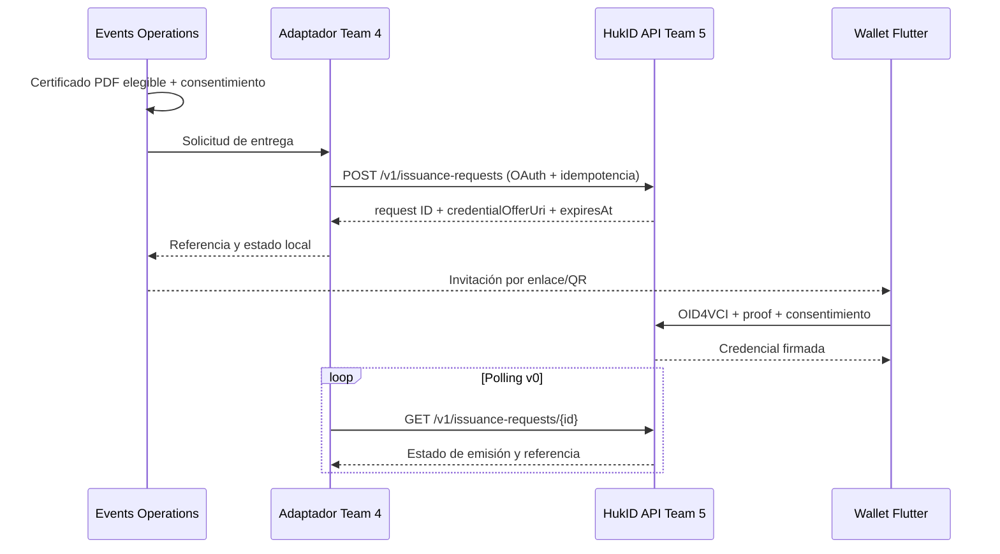

# Arquitectura

## Dos productos y dos niveles de separación

Events se distribuye por perfiles de carga y ownership. HukID es un producto externo con backend modular Go y wallet Flutter; sus módulos internos no equivalen a microservicios desplegados individualmente.

| Producto / owner | Componentes y autoridad |
| --- | --- |
| Events Team 1 | Astro/CDN, CMS/React Admin shell, gateway/OIDC, tenant directory y proyección pública. |
| Events Team 2 | Configuration API, agenda/formularios y releases. |
| Events Team 3 | Participation API, capacidad, registros, postulaciones y tickets. |
| Events Team 4 | Onsite PWA/API, workers, comunicaciones, reporting, PDF y adaptador outbound. |
| HukID Team 5 | API modular, worker, issuer/OID4VCI, status, KMS adapters y wallet Flutter; verificación opcional. |

## Flujo entre productos

El canal concreto hacia el participante se confirma por piloto; la oferta no reemplaza la autenticación requerida para documentos nominativos. Events conserva su PDF y referencia externa; la wallet recibe la credencial desde HukID.

## Persistencia y protocolos

Events usa bases lógicas propias e integración por eventos versionados con outbox/inbox. HukID no consume el bus Events ni comparte sus tablas, credenciales o transacciones. Sus tablas internas pueden relacionarse dentro de su propia DB PostgreSQL; la prohibición de FK cross-service no prohíbe integridad interna de HukID.

HukID empieza con API y worker, PostgreSQL, object storage y KMS. Extraer signing/status/verification sólo ante necesidad de aislamiento, carga, regulación u ownership medible. Blockchain no es dependencia de emisión ni verificación.

## Detalle por tema

- [Events: arquitectura](events-architecture.md) y [Architecture Spine AD-1–12](events-architecture-spine.md).
- [HukID: arquitectura modular y estados](hukid-architecture.md).
- [Wallet/backend y nodos](hukid-wallet-backend.md).
- [Perfil HukID v0.1-draft](hukid-profile.md) y [estándares/modelo](hukid-standards-and-model.md).
- [Integración Events](contracts/events-integration.md), [datos](data-model.md), [contratos](api-contracts.md) y [ADR-0001](../decisions/ADR-0001.md).
