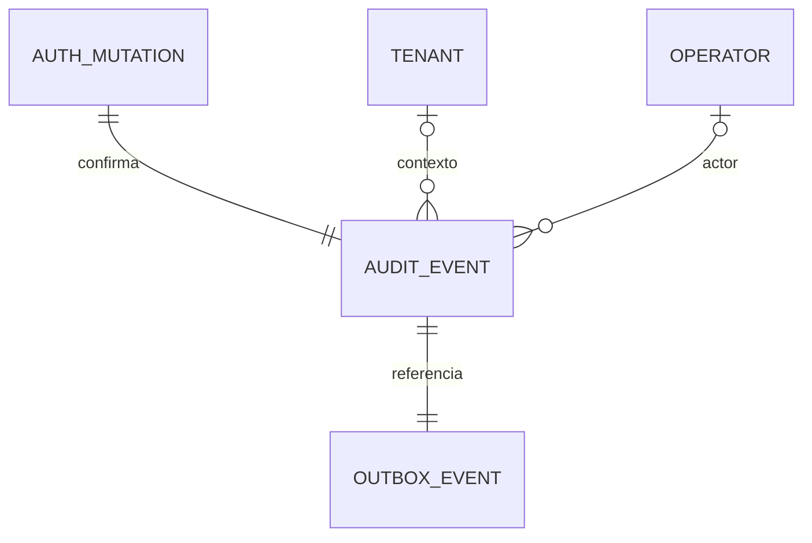

# Auditoría de autenticación de consola

Estado: implementada y probada en laboratorio AUTH-T09, 2026-11-05. Decisión: [ADR-0010](../decisions/ADR-0010.md). Esta referencia está dirigida a quienes mantienen Platform y sus pruebas; AUTH-T10 añade [operación y gate de laboratorio](../05-delivery/authentication-gate.md).

## Eventos y correlación

La auditoría utiliza las tablas propias platform.audit_events y platform.outbox_events, ampliadas mediante [0006_auth_audit.sql](../../src/platform/internal/adapters/postgres/migrations/0006_auth_audit.sql). No se crea otro servicio ni se publica en el bus Events.

| Acción | Momento y referencias |
| --- | --- |
| auth.login.started / auth.step_up.started | Creación confirmada de transacción OIDC; target es su UUID. No presupone autenticación completada. |
| auth.login.completed | Creación de identidad mínima y sesión inicial; actor local verificado y familia como target. |
| auth.step_up.completed | Rotación confirmada tras reautenticación verificada; actor, familia y tenant seleccionado si existe. |
| auth.context.changed | Rotación tras selección autorizada; actor, familia y tenant de destino autorizado. Seleccionar de nuevo el mismo tenant también rota y genera evento. |
| auth.refresh.completed | Rotación confirmada tras refresh; actor, familia y contexto conservado. |
| auth.logout.completed | Primera invalidación local por logout; actor, familia y contexto anterior. Un logout repetido válido responde sin duplicar el cambio. |
| auth.family.revoked | Transición active→revoked por logout, reuse, incertidumbre o mantenimiento. Target es la familia; no incluye una razón derivada de entrada libre. |
| auth.request.denied / auth.request.failed | Respuesta HTTP 4xx / 5xx en superficies /console/ y /v1/operator/. Actor y tenant null; target es la correlación del request. |

El middleware genera un UUID nuevo por petición; ignora X-Correlation-Id recibido. El mismo valor viaja en contexto Go, cabecera X-Correlation-Id, Problem Details y eventos de esa petición. Las operaciones internas sin petición generan su propia correlación. No se promete una traza distribuida entre requests: el target permite agrupar los cambios de una familia; el inicio OIDC usa otro target de transacción.

Los rechazos registran sólo acción, outcome denied, UUIDs y fecha. El log estructurado registra mensaje fijo, correlationId y estado HTTP; permite enlazarlo con la auditoría sin copiar método, URL, cabeceras, body, IP, issuer/subject o descripciones externas. Las lecturas exitosas /me/context no generan eventos de autenticación.

## Modelo e integridad

| Campo | Semántica |
| --- | --- |
| event_id | UUID aleatorio generado en servidor; clave primaria. |
| tenant_id | UUID de tenant autorizado o null para hechos globales/preautenticación. Nunca tenant solicitado sin verificar. |
| actor_operator_identity_id | UUID de identidad local verificada o null; no correo ni subject del IdP. |
| target_id | UUID de transacción, familia o correlación; no FK a sesión, para conservar evidencia tras la purga. |
| action / outcome | Vocabulario de acciones cerrado por policy RLS; success en cambios confirmados, denied en respuestas rechazadas/fallidas. |
| correlation_id / recorded_at | UUID server-side y fecha asignada por PostgreSQL. |
| audit_scope | Columna generada interna: UUID de tenant como texto o marcador global para hechos globales. Asegura FK compuesta incluso cuando tenant_id es null. |

La migración conserva las filas previas y permite tenant null sólo para acciones auth enumeradas. Outbox conserva sus campos mínimos event_id, tenant_id, recorded_at y published_at; añade scope generado para verificar que evento y referencia pertenecen al mismo contexto. No hay JSON/payload libre. El marcador global de scope es interno y no puede coincidir con el texto de un UUID de tenant.

RLS continúa forzada. Sólo hukid_session_runtime obtiene INSERT por columnas y acciones de autenticación. No obtiene SELECT, UPDATE, DELETE ni permiso de marcar publicación. Los roles context/tenant no escriben auditoría. Las restricciones/FK existentes y nuevas mantienen integridad para registros globales y de tenant. La administración productiva de lectura, retención y publicación conserva trabajo posterior.

## Transacciones y fallos

Los éxitos se escriben junto con su cambio y outbox en una misma transacción PostgreSQL. Si falla evento u outbox, se revierte el cambio y no se entrega éxito/cookie. Esto incluye inicio OIDC, sesión inicial, rotaciones y revocaciones. El consumo OIDC sigue confirmado antes del intercambio; un fallo posterior no rehabilita code/state. Las llamadas IdP siguen fuera de los locks de DB.

Las rotaciones conservan CAS/locks por familia y generación. Sólo la operación ganadora genera éxito. Logout repetido no duplica logout.completed ni family.revoked. La purga no borra auditoría ni depende de conservar la sesión referenciada.

Las denegaciones HTTP se registran aparte después del handler, con contexto independiente de la cancelación del cliente y deadline de un segundo, sin reintentos. Una DB caída puede impedir conservar ese evento: se mantiene el rechazo y se emite auth audit unavailable con correlación, sin el error SQL. No hay garantía durable frente a caída del proceso antes de registrar una denegación. Este límite exige observación/alertas operativas posteriores; nunca concede acceso.

## Exclusión de secretos

Los eventos no reciben code, state, nonce, verifier, cookie, CSRF, tokens, digests ni claves; tampoco payloads, headers, errores arbitrarios o datos personales del IdP. Los parámetros OIDC sólo recorren sus canales de protocolo. Tokens/verifier recuperables continúan cifrados temporalmente en los almacenes privados según el [contrato](console-auth-contract.md); auditoría/outbox no los replican.

El ErrorLog de net/http se sustituye por un mensaje fijo porque su diagnóstico de panic puede incluir valores privados de dependencias. No se configura un access log con URL/query. Las pruebas inspeccionan logs de API y filas audit/outbox; no certifican redacción de proxies, agentes externos, volcados de memoria o PostgreSQL productivo.

## Verificación y límites

- Unitarias: correlación nueva, entradas hostiles y secretos en errores no reflejados, 4xx/5xx, caída de auditoría, cancelación del cliente y 32 peticiones concurrentes. Un servidor HTTP de prueba provoca panic con un secreto sintético y verifica el diagnóstico fijo.
- PostgreSQL real descartable: upgrade con historia preservada, grants/RLS, login y rotación revertidos ante fallo de evento/outbox, logout concurrente sin duplicación y correspondencia de eventos/outbox.
- Binario HTTP con IdP/DB reales de laboratorio: eventos de todos los flujos, negativos existentes y búsqueda de códigos, state/nonce, cookies, CSRF, tokens y claves capturados en logs y auditoría.
- Chromium: recorrido de AUTH-T08 con eventos presentes en DB, outbox completo y exclusión de secretos de configuración en logs/auditoría. Las pruebas previas conservan sus comprobaciones de storage y contexto visual.

Comandos: npm run check, npm run test:postgres, npm run build, npm run smoke y npm run test:browser; detalle de entorno en [desarrollo local](../04-engineering/local-development.md), evidencia fechada en [tareas](../features/FEAT-001-authentication/tasks.md).

No se entrega visor audit, worker de publicación, retención institucional, WORM, SIEM, métricas operativas, carga, restore o MFA real. AUTH-T10 entrega [runbook y gate de laboratorio](../05-delivery/authentication-gate.md); operación productiva sigue pendiente. El perfil de credenciales sigue draft.
