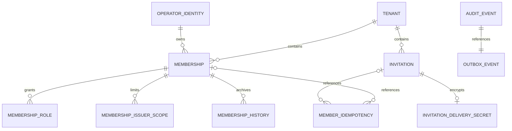

# Persistencia de miembros e invitaciones — USR-T02

Estado: foundation de almacenamiento de laboratorio. La [migración 0007](../../src/platform/internal/adapters/postgres/migrations/0007_console_members.sql) amplía AUTH sin reescribir las migraciones 0001–0006. No implementa las doce operaciones HTTP del [contrato](console-members-contract.md), entrega, canje OIDC ni UI. Decisión: [ADR-0012](../decisions/ADR-0012.md).

## Modelo y diccionario

Evolución posterior: [USR-T04](console-invitation-delivery.md) conecta creación/revocación, cifrado/purga y worker, y añade recibos sintéticos mediante 0008. Este documento conserva el alcance de la foundation 0007; sus límites históricos no sustituyen el estado vigente de las [tareas](../features/FEAT-002-user-management/tasks.md).

PostgreSQL 18.6 y pgx existentes. La identidad canónica continúa en operator_identities con unicidad issuer/subject. No hay tabla users ni búsqueda de identidad por correo.

| Registro / campo | Tipo y nulabilidad | Integridad y propósito |
| --- | --- | --- |
| memberships.lifecycle | bigint no null, 1–2^53−1 | Generación del acceso en la membership lógica existente, inicialmente 1. No cambia el ID ni la identidad. |
| memberships.updated_at / lifecycle_started_at / revoked_at | timestamptz; revoked_at nullable | Fechas de proyección, comienzo del lifecycle y corte de revocación. CHECK de orden temporal; los comandos futuros deben mantener estado/fechas y revisión monotónica juntos. |
| membership_issuer_scopes | UUID tenant/member/issuer no null | PK triple y FK compuesta a membership; sólo almacena asignación validada. No existe FK a un catálogo issuer ausente. |
| membership_history | tenant/member/lifecycle, revisión, arrays roles/issuerIds, started_at/revoked_at; no null | Snapshot final de lifecycle revocado, PK triple y FK compuesta. Runtime sólo SELECT/INSERT, sin UPDATE/DELETE. No es un historial de cada edición. |
| invitations | UUID id/tenant/created_by, token_hash bytea(32), roles text[], issuer_ids uuid[], estados y revisión | Unicidad global del hash y del ID; roles cerrados/distintos y relación issuer_operator/issuerIds; estados coherentes con aceptación/revocación. Referencias de membership siempre tenant-scoped. |
| invitations.recipient_* | HMAC bytea(32), ciphertext con tag, nonce bytea(12), key version; todos presentes o todos null | Destinatario cifrado y deduplicación tenant/HMAC. El índice único parcial permite un pending por destinatario/tenant; no usa now() en su predicado. No hay email/token crudo. |
| invitations.created_at / expires_at / recipient_delete_after | timestamptz no null | Expiración posterior a creación; retención no anterior al vencimiento. La política de TTL se calcula en aplicación; SQL no incorpora los defaults test. |
| invitations.target_membership_id / target_lifecycle / target_revoked_at | UUID, bigint, timestamptz nullable | Binding opcional cuando una identidad confiable permite conocer el target; lifecycle requiere target y la invitación debe ser posterior al corte indicado. No se infiere el target por email. |
| invitations.accepted_membership_id / accepted_lifecycle / accepted_at | UUID, bigint, timestamptz nullable | Obligatorios sólo en accepted; aceptación dentro del deadline. Conservan el lifecycle canjeado aunque después avance la proyección. |
| invitation_delivery_secrets | tenant/invitation, generation, ciphertext, nonce, key version, created_at/delete_after; no null | PK tenant/invitation y FK compuesta; envelope recuperable separado, eliminable sin borrar la invitación ni su hash. |
| member_idempotency | tenant/actor/operation, key_hash/request_hash, created_at/expires_at; no null | Huellas de 32 bytes y referencias seguras; nunca request/response JSON, email, token ni key crudos. Índice único administrativo tenant/actor/operación/key; aceptación actor/operación/token_hash/key. |
| platform.audit_events / outbox_events | Envelope mínimo existente | Vocabulario USR cerrado, actor/target opacos y correlación. Sin payload de notificación ni secretos. |

Todas las FK conservan datos mediante NO ACTION; no hay cascadas de borrado de identidad, membership o evidencia. Los índices de páginas siguen tenant/created_at/ID. Los de retención siguen tenant/deadline. No se afirman planes de consulta ni rendimiento bajo carga todavía no medidos.

## Compatibilidad y reingreso

El expand conserva identidad, membership lógica única, roles, sesiones y evidencia AUTH. Backfill asigna lifecycle=1 y lifecycle_started_at=created_at. Para memberships ya revocadas no se conoce la fecha original: revoked_at recibe el instante de migración como corte conservador y se archivan revisión/grants existentes. No se presenta esa fecha como el momento histórico real. Se conservan incluso grants legacy incompletos; la migración no los corrige ni concede permisos nuevos.

Los comandos USR-T05/T06 deben revocar bajo lock, incrementar revisión, fijar revoked_at y llamar a ArchiveRevokedMembership antes de sustituir grants. Un reingreso posterior conserva ID/identidad, avanza lifecycle/revisión e instala sólo grants de la invitación nueva. El archivo anterior queda inmutable para runtime. SQL prepara estas columnas y restricciones; la máquina completa de transiciones/autorización pertenece a esos comandos, no a un trigger implícito que cambie el comportamiento de AUTH.

Si el destinatario aún no tiene identidad conocida, el binding target permanece null. Al aceptar debe resolverse la misma identidad verificada y, bajo el lock, comparar created_at de invitación contra revoked_at vigente, además del binding cuando exista. Nunca aceptar una invitación anterior al último corte ni eludir suspended. El lookup mínimo del hash antes de conocer tenant y la evidencia email siguen pendientes en USR-T05; no se concede SELECT global para resolverlos.

## Rol, RLS y transacción

hukid_members_runtime es NOLOGIN, NOBYPASSRLS y no propietario. Necesita una credencial backend independiente; no se provisiona ni conecta a la API automáticamente. OpenRuntimePool lo admite y rechaza combinaciones con los tres roles AUTH, propietario, lector privilegiado, flags elevados o ownership de relaciones.

RLS forzada filtra las tablas nuevas y las tablas tenancy reutilizadas por tenant de contexto. Contexto ausente devuelve cero filas; escritura fuera del tenant falla. Los roles AUTH mantienen sus permisos anteriores y no leen invitaciones. El rol de miembros no lee identidad global/sesiones ni cambia tenant, identidad de membership, historia o publicación de outbox. Los UUID/GUC son entradas confiables del backend: **este rol permite directorio y mutaciones dentro del tenant seleccionado; RLS no autentica al actor ni comprueba su capacidad**. USR-T03–T07 deben autorizar antes de leer y reautorizar antes de escribir/replay. El rol no se entrega al navegador ni a operadores SQL.

[WithMemberMutation](../../src/platform/internal/adapters/postgres/members.go) usa WithTenant/SET LOCAL y advisory lock transaccional sobre el agregado tenant. La clave deriva del UUID normalizado en PostgreSQL, de modo que mayúsculas u otras grafías no separan locks. Una colisión de hash sólo serializa tenants adicionales. Con READ COMMITTED, las consultas posteriores al lock ven el commit del escritor anterior. Todos los escritores USR deben usar esta primitiva y mantener el orden tenant → actor/target/invitación → idempotencia/historial. Los cambios administrativos directos externos a este protocolo no están cubiertos.

Tras el lock comprueba tenant activo. Dentro del callback se deben revalidar actor, MFA, revisión, grants y último admin, o identidad/destinatario para aceptación sin membership. No se mantienen locks durante OIDC o entrega externa. La primitiva exige un evento válido y confirma cambio/evento/outbox en una sola transacción; fallos, panic y cancelación hacen rollback y liberan contexto/lock. No proporciona todavía la política de replay ni el 409 operation_in_progress de los handlers futuros.

## Auditoría y privacidad

AUTH y USR reutilizan appendEvent y las mismas tablas. El rol USR sólo puede insertar success, tenant/actor de contexto y estas acciones: members.invitation.created/revoked/accepted/expired, members.delivery.sent/failed, members.membership.changed/revoked/reentered y members.retention.purged. Target es el UUID de invitación/membership o correlación de mantenimiento. No hay campos de razón libre ni metadata JSON. No se añaden acciones USR al rol de sesión AUTH. Las denegaciones HTTP conservan AUTH-T09 cuando se conecten los handlers.

Las CHECK de envelopes prueban forma, no autenticidad AES-GCM, AAD, propiedad del email ni seguridad de claves. USR-T04 debe generar/cifrar el destinatario y material de entrega, limitar delete_after al mínimo definido por la política, purgar tras sent/aceptación/revocación/deadline y deduplicar al proveedor. El secreto permanece separado del registro de hash; outbox sólo referencia el evento cuyo target es la invitación. No hay worker ni PII de entrega en outbox.

La estructura permite purgar envelopes, fingerprints vencidos y las cuatro columnas de destinatario sin borrar hash, membership, archivo o audit. No hay purga programada/SLA de retención con T02; T04/T09 conectarán ese mantenimiento y sus pruebas temporales. No eliminar historia por los TTL de invitación.

No existe aún catálogo/puerto operativo de ownership issuer. El almacenamiento acepta UUIDs estructurales, pero ninguna operación HTTP concede grants: se mantiene el rechazo cerrado/503 exigido por el contrato hasta integrar una fuente confiable. No se crean emisores ficticios para satisfacer una FK.

## Migración, verificación y reversión

Migrar únicamente mediante el runner/checksums existentes. El harness crea su propio clúster/bases; no se migró una DB de usuario ni productiva. Rollout futuro requiere provisioning separado de la credencial de miembros. No hay down ni borrado: deshabilitar las escrituras USR y conservar el expand al retirar el incremento. El código AUTH anterior sigue operando sobre las columnas previas; la reversión después de comandos de lifecycle/grants debe volver a evaluarse al implementarlos.

[Pruebas PostgreSQL](../../src/platform/internal/adapters/postgres/members_integration_test.go): upgrade 0006→0007 con identidad/evidencia y snapshot revocado preservados; RLS/default deny/dos tenants/pool físico reutilizado; separación de credenciales; FK/unique/CHECK; rollback de invitación ante fallo de audit/outbox; archivo/reemplazo de proyección sin duplicar membership; almacenamiento/purga de fingerprints/destinatario; carrera de dos últimos administradores con guard Go dentro del lock; UUID equivalente, cancelación de waiter y liberación tras error/panic/cancelación. Los fixtures de mutación no sustituyen handlers ni prueban autorización HTTP USR.

Comandos: npm run check, npm run test:postgres, npm run build y npm run smoke; evidencia fechada de ejecución en [tareas FEAT-002](../features/FEAT-002-user-management/tasks.md). USR-T03 es el siguiente incremento. Cargas, restore, retención institucional, entrega/IdP reales y gate productivo siguen pendientes.
