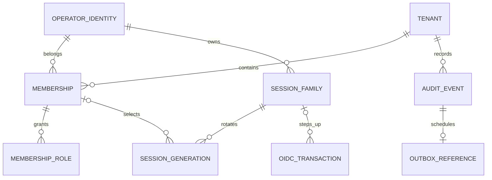

# Persistencia de consola — AUTH-T03

Estado: DDL nuevo ejecutado y probado en PostgreSQL 18.6 descartable; no es el DDL histórico del issuer. AUTH-T04 añade [login/callback, cifrado y sesión inicial](console-oidc-login.md), conectando HTTP con PostgreSQL. AUTH-T05 añade [lecturas autorizadas](console-operator-context.md) y AUTH-T06 [rotación, refresh/logout y purga](console-session-lifecycle.md); administración de miembros sigue pendiente. Este documento conserva el detalle de foundation AUTH-T03.

## Artefactos y decisiones

- [0001_console_foundation.sql](../../src/platform/internal/adapters/postgres/migrations/0001_console_foundation.sql): roles, identidades, tenants, memberships, roles locales, registros de sesión/transacción y referencias mínimas de audit/outbox.
- [0002_console_isolation.sql](../../src/platform/internal/adapters/postgres/migrations/0002_console_isolation.sql): RLS forzada, grants mínimos y funciones de descubrimiento.
- [Runner de migraciones](../../src/platform/internal/adapters/postgres/migrate.go): migraciones embebidas, ledger, checksums y advisory lock.
- [Acceso transaccional](../../src/platform/internal/adapters/postgres/context.go): pools con verificación de privilegios, contexto local y descubrimiento por un puerto separado.
- [Bootstrap sintético](../../src/platform/internal/adapters/postgres/bootstrap_testenv.go) y [CLI testdb](../../src/platform/cmd/testdb/main.go): provisioning local restringido, nunca endpoint público.
- [Pruebas PostgreSQL](../../src/platform/internal/adapters/postgres/persistence_integration_test.go) y [harness](../../scripts/test-postgres.mjs): clúster descartable, bases creadas por la prueba y limpieza de sus recursos.

El [ADR-0004](../decisions/ADR-0004.md) adopta este incremento. El [contrato AUTH-T02](console-auth-contract.md) sigue siendo la fuente de semántica HTTP, políticas y modelo de sesión; este documento detalla únicamente la persistencia.

## Relaciones y diccionario

| Registro | Claves, estados y restricciones actuales |
| --- | --- |
| `tenancy.operator_identities` | UUID opaco; unicidad case-sensitive `(oidc_issuer, subject)`. Identidad pseudónima global, sin email ni contraseña. No es entidad tenant-scoped. |
| `tenancy.tenants` | UUID, nombre de presentación y estado active/suspended. |
| `tenancy.memberships` | UUID, tenant y operador; una membership lógica por pareja, estado active/suspended/revoked, revisión positiva. UNIQUE `(tenant_id, membership_id)` permite FK compuestas. |
| `tenancy.membership_roles` | PK `(tenant_id, membership_id, role)`; FK compuesta impide asociar la membership de otro tenant. Sólo los cuatro roles de la matriz AUTH-T02. |
| `console_auth.session_families` | Actor, origen humano, política, evidencia MFA, creación y expiración absoluta; estado active/revoked/expired y revisión CAS. |
| `console_auth.sessions` | Generación única por familia, cookie hash único y CSRF hash de 32 bytes; actor/deadline ligados a la familia por FK compuesta; idle ≤ absoluto. Selección tenant/actor ligada a membership y revisión nula si no hay selección. |
| `console_auth.oidc_transactions` | Hashes de state/nonce/binding de 32 bytes; state único; login sin familia o step_up con familia; expiración posterior a creación. Consumir exige borrar el envelope del verifier en la misma actualización. |
| `platform.audit_events` | Actor/target opacos, tenant, acción, resultado, correlación y fecha. Sin JSON arbitrario, claims, códigos, emails o payload sensible. |
| `platform.outbox_events` | Referencia mínima al audit event con FK `(tenant_id, event_id)`, fecha y marcador published. No hay worker ni bus Events; es una foundation de publicación propia HukID. |

Todos los timestamps son `timestamptz`. Los índices cubren identidad estable, consulta de memberships por operador, lookup de cookie/state y expiración. No hay índices ni objetivos de rendimiento inventados para cargas todavía no medidas.

Los registros de sesión/transacción guardan únicamente hashes de búsqueda y envelopes recuperables, no columnas de tokens/verifier en claro. El envelope de secretos de una generación agrupa access/refresh/CSRF; guarda ciphertext con tag, nonce de 12 bytes y key version, más digest de refresh separado. El ciphertext activo debe existir y los registros rotated/revoked/expired deben purgarlo. La familia puede quedar revocada antes de modificar generaciones sólo dentro de una transacción que haga ambos cambios: AUTH-T06 implementa ese orden y prueba su rollback; véase el ciclo de sesión.

Las CHECK verifican forma y coherencia del envelope, no autenticidad AES-GCM. El adaptador criptográfico productivo y gestión de claves quedan en AUTH-T04/T06; una prueba almacena un envelope sintético generado con AES-GCM para comprobar compatibilidad. Su key sólo vive en memoria. AAD debe incluir propósito, familia/generación (o transaction ID para verifier); no se guarda ni entrega una clave desde PostgreSQL. Las FK no prueban que una membership esté activa: esa autorización se vuelve a consultar, además del límite estructural.

La unicidad de membership y los estados son foundation. Terminalidad, reinvitación con historial, revisión ante cada mutación, alcance issuer y protección del último administrador se implementarán con USR-T01 y sus tareas, sin exponer ahora comandos de escritura. No se fabrican tablas de issuer para añadir una FK a un módulo aún ausente.

## Roles, RLS y fronteras de confianza

| Rol de grupo | Acceso |
| --- | --- |
| `hukid_owner` | NOLOGIN, propietario del DDL; nunca lo hereda una conexión de aplicación. |
| `hukid_tenant_runtime` | SELECT de tenant, membership y roles propios del contexto. Sin escrituras, TRUNCATE, identidad global ni acceso a secretos. |
| `hukid_context_runtime` | Sólo funciones de resolución exacta issuer/subject y lista de contextos propios. Sin SELECT directo de tablas. |
| `hukid_context_reader` | NOLOGIN, propietario de esas funciones SECURITY DEFINER; NOBYPASSRLS y sin ownership de tablas. RLS lo limita al operador de la transacción, sin policy `USING(true)`. El caller no hereda este rol. |
| `hukid_session_runtime` | CRUD de las tres tablas privadas `console_auth`, sin tablas tenant ni directorio global. No tiene una sesión tenant fija, porque el login precede a la selección y puede acceder a varias memberships. |

Los cinco roles son NOSUPERUSER/NOCREATEDB/NOCREATEROLE/NOREPLICATION/NOBYPASSRLS. Los logins reales se provisionan fuera del SQL versionado; las pruebas crean logins y contraseñas aleatorias efímeras. `OpenRuntimePool` rechaza superuser, flags privilegiados directos/heredados, membership del owner/lector privilegiado y ownership de relaciones de los schemas de aplicación. Es una validación al abrir el pool, no monitorización continua de cambios administrativos.

`FORCE ROW LEVEL SECURITY` se aplica a tenants, memberships, roles, audit y outbox. Audit/outbox aún no reciben grants runtime ni policies de lectura/escritura: esas superficies se ampliarán explícitamente en AUTH-T09/USR. Las tablas globales de identidad y sesión no usan tenant_id artificial; su protección se basa en roles separados, funciones mínimas y secretos cifrados.

`WithTenant` abre transacción y usa `set_config(..., true)`, equivalente parametrizado de `SET LOCAL`, para actor y tenant. Commit, error, panic y cancelación terminan o descartan la transacción antes de reutilizar el pool. No se usa `SET` de sesión ni se interpolan identificadores recibidos. El fixture verifica una misma conexión física para A/A → A/B denegado → B/B, y ausencia de contexto tras los caminos de salida.

Los GUC no validan JWT: actor y tenant deben proceder del backend autorizado. RLS añade aislamiento; no sustituye AUTH-T04/T05. Un login SQL de backend es una frontera de confianza, no una credencial para navegador. El puerto de descubrimiento recibe issuer/subject ya verificados y sólo devuelve actor opaco y tenants activos propios; no es un directorio de búsqueda.

Las funciones SECURITY DEFINER usan SQL fijo, nombres totalmente calificados, search_path seguro, EXECUTE revocado a PUBLIC y owner no propietario/NOBYPASSRLS. No aceptan SQL, filtros o tenant arbitrarios. El SELECT de tenant también requiere tenant activo y membership activa. El SELECT directo de la metadata de membership/rol propio no representa permiso operativo de un tenant suspendido; el contexto autorizado siempre pasa por tenant activo. El futuro middleware deberá revalidarlo en cada petición.

## Migraciones y provisioning

Los nombres `0001`/`0002` son la secuencia nueva de consola. No corresponden a los `database/001_initial.sql` y `002_integrity...` ausentes del issuer. El runner registra nombre/SHA-256/fecha, serializa migradores con advisory lock y aplica cada archivo más su ledger en una transacción. Rechaza cambios de checksum, huecos o versiones desconocidas. Sólo normaliza CRLF→LF para que checkout Windows/Linux no cambie el checksum. No hay down, DROP de datos reales ni modificación automática de migraciones ya aplicadas.

`0001` crea la foundation sin grants runtime; `0002` añade el aislamiento. El test de upgrade inserta datos con `0001` y demuestra que `0002` los conserva. La creación de roles es global al clúster y requiere una conexión administrativa dedicada; los roles existentes con flags inseguros se rechazan. Producción requiere provisioning/credenciales/operación aprobados por separado.

El CLI sólo acepta `HUKID_ENV=test`, `HUKID_TEST_DATABASE=1`, conexión explícita a IP loopback, base con prefijo `hukid_test_`, sin hosts fallback y `sslmode=disable` exclusivo del laboratorio local. No carga `.env` ni arranca desde la API. Un nombre con prefijo test no demuestra que una base esté vacía: el operador debe elegir una base de pruebas propia. El harness elimina esa ambigüedad creando sus propios clúster y bases nuevas.

El bootstrap requiere además al administrador del clúster aislado. Inserta dos tenants con sus operadores/memberships administrativas y una identidad adicional sin membership para probar acceso pendiente, con issuer test, audit y outbox en una sola transacción. No crea passwords de operador, IdP, sesiones ni un endpoint de registro. Un advisory lock y dos eventos marcadores hacen repetible la operación; si ya se completó, no reactiva ni vuelve a conceder roles. Un conflicto parcial aborta y no sobreescribe datos. AUTH-T04 añade alta de identidad tras validar OIDC mediante la migración 0003; el descubrimiento consulta identidades existentes y no concede membresías.

## Pruebas y límites

Este apartado conserva la evidencia foundation de AUTH-T03. La suite acumulada también cubre login/callback, contexto, sesiones/comandos y upgrades posteriores, según [desarrollo local](../04-engineering/local-development.md). AUTH-T08 añade el [recorrido de navegador](console-auth-interface.md); las limitaciones históricas de AUTH-T03 no anulan esas pruebas posteriores.

`npm run test:postgres` exige PostgreSQL 18.6; no salta pruebas si faltan binarios. Inicializa un clúster en `.cache/postgres-tests`, liga el listener sólo a loopback/puerto libre y genera un password administrativo efímero. Ejecuta ocho pruebas Go con build tag `integration`, incluido el CLI real de migración/bootstrap, cierra conexiones, elimina sólo las bases/logins que creó y detiene su servidor. El directorio del clúster queda ignorado para diagnóstico; no se instala un servicio ni se usa una DB existente.

Se verifican: base vacía/upgrade con datos; checksums y versiones desconocidas; RLS y grants; dos tenants con un pool de una conexión; rollback/panic/cancelación; suspensión/revocación; descubrimiento mínimo; FK/unique/CHECK de identidad, tenant y sesiones; deadline absoluto; eliminación de secretos al invalidar/consumir; CAS de transacción OIDC; rollback de bootstrap por fallo de outbox; idempotencia sin regrant; rechazo de roles elevados y destinos/flags no test. La restricción de nonce/ciphertext no demuestra por sí sola cifrado productivo.

No se han probado restauración/DR, perfiles de carga, migrations sobre DDL externo, workers, refresh concurrente ni cookies/CSRF en navegador. AUTH-T04 amplía esta foundation con login/callback HTTP, cifrado y sesión inicial; su evidencia y límites se mantienen en [login OIDC](console-oidc-login.md). La sesión operativa continúa en AUTH-T05/T06.

Fuentes de implementación: [PostgreSQL RLS](https://www.postgresql.org/docs/18/ddl-rowsecurity.html), [funciones y SECURITY DEFINER](https://www.postgresql.org/docs/18/sql-createfunction.html), [pgx y su changelog](https://github.com/jackc/pgx/blob/master/CHANGELOG.md). Configuración local, versiones y evidencia: [desarrollo local](../04-engineering/local-development.md).

## Migración AUTH-T06

[0004_session_lifecycle.sql](../../src/platform/internal/adapters/postgres/migrations/0004_session_lifecycle.sql) añade lease/deadline coherentes e índice único de generación activa por familia. La semántica de rotación, bloqueo y mantenimiento se mantiene en [ciclo de sesión](console-session-lifecycle.md). Las migraciones anteriores permanecen inmutables.

## Migración AUTH-T07 y panel AUTH-T08

[0005_console_reauthentication.sql](../../src/platform/internal/adapters/postgres/migrations/0005_console_reauthentication.sql) liga transacciones step_up a una generación de sesión mediante FK y CHECK. El detalle y los upgrades probados están en [reautenticación](console-reauthentication.md). AUTH-T08 conecta el panel y sus pruebas sin nuevas migraciones ni ampliación de grants. La administración real de memberships conserva FEAT-002.
