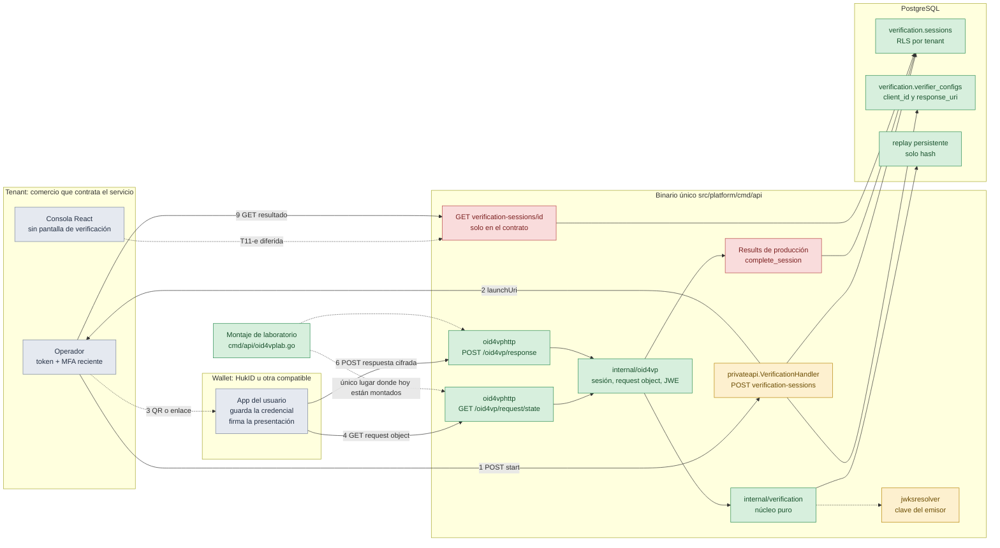
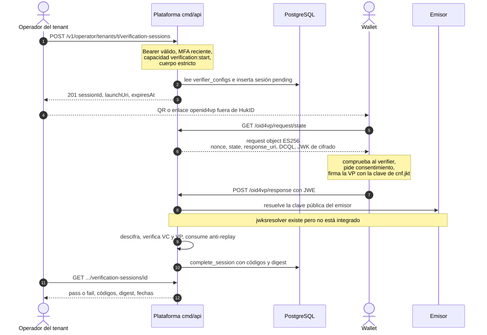
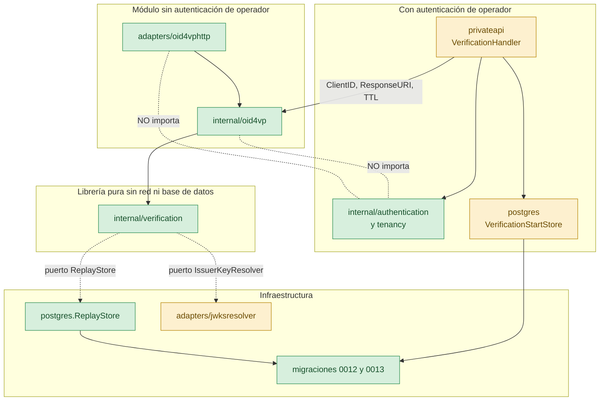
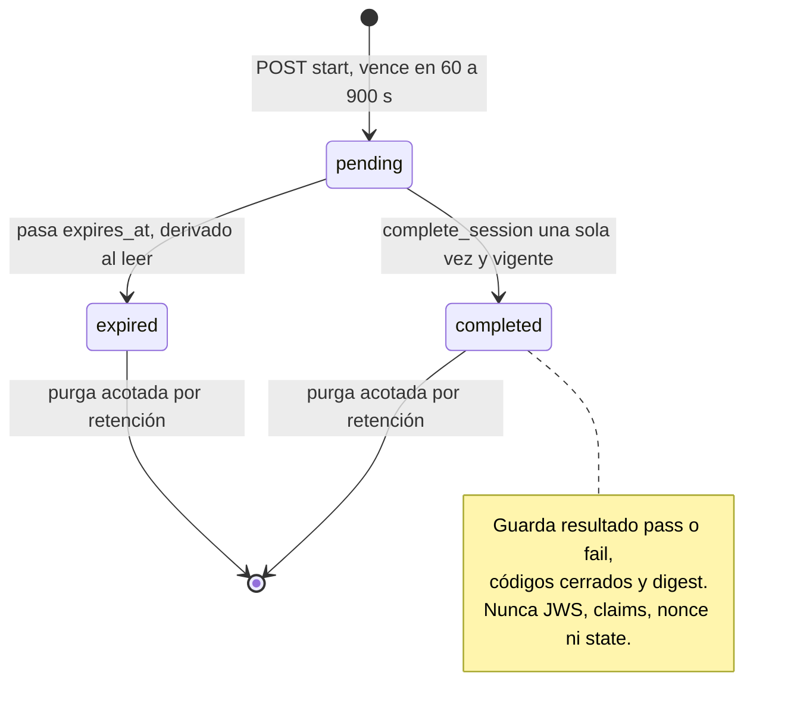

# Arquitectura del servicio de verificación de credenciales

Estado: diagramas del servicio de verificación de HukID (FEAT-004) tal como está en `develop` el **2026-11-17** (`e4fcf51`). Describen relaciones y estado de implementación; no son contrato normativo. Los detalles normativos están en el [contrato del núcleo](credential-verification-contract.md), el [perfil HukID](hukid-profile.md) §9–§10, [ADR-0030](../decisions/ADR-0030.md), [ADR-0031](../decisions/ADR-0031.md), [ADR-0033](../decisions/ADR-0033.md) y el [contrato OpenAPI de sesiones](../../src/platform/contracts/verification-sessions.openapi.json). El estado por tarea vive en [tasks.md](../features/FEAT-004-credential-verification/tasks.md); si difiere de este documento, manda `tasks.md`.

Leyenda de color: verde, hecho y probado; amarillo, hecho sin conectar; rojo, falta; gris, actor externo al servicio.

## 1. Arquitectura

El servicio es un módulo del binario `cmd/api` ([ADR-0031](../decisions/ADR-0031.md) #1). Los endpoints del wallet son públicos; los del tenant exigen token de operador con MFA reciente.

## 2. Flujo completo con el wallet

Los pasos 8 y 9 (completar la sesión y consultar el resultado) y la resolución real de la clave del emisor son los que hoy no están conectados.

## 3. Capas y regla de imports

[ADR-0030](../decisions/ADR-0030.md): el módulo del wallet no puede importar `internal/authentication`. Solo el adaptador autenticado entrega al módulo el cliente, la URI de respuesta y el tenant ya autorizado.

## 4. Estados de una sesión

La base solo guarda `pending` y `completed`. `expired` se deriva de `expires_at` al leer. Una sesión se completa una sola vez y solo si sigue vigente.

## Estado por componente (2026-11-17)

| Componente | Estado | Detalle |
| --- | --- | --- |
| `internal/verification` | Hecho | Seis checks técnicos y 21 códigos cerrados. `status` y `schema` salen como `skipped` (VER-T09 y VER-T13). |
| `internal/oid4vp` y `oid4vphttp` | Hecho | Montados solo en el laboratorio. Una clave de firma por proceso. |
| Migraciones 0012 y 0013 | Hecho | Replay persistente y sesiones con RLS por tenant. Sin columnas de clave. |
| Capacidades `verification:*` | Hecho | Para `tenant_admin` y `security_admin`; el inicio exige MFA. |
| `VerificationHandler` (inicio) | Hecho, sin conectar | Probado con Postgres real; `cmd/api` no lo referencia. |
| `jwksresolver` | Hecho, sin conectar | Probado con un servidor TLS local; no integrado ni probado contra un JWKS real. |
| `Results` de producción y mapa `state` a `session_id` | Falta | El laboratorio solo imprime el reporte en la terminal. |
| Lectura (`GET`) y replay por tenant | Falta | La lectura solo existe en el contrato. |
| Clave de firma por tenant | Falta | Custodia abierta ([ADR-0033](../decisions/ADR-0033.md) #7). Bloquea el montaje en producción. |
| Pantalla en la consola | Falta | [ADR-0031](../decisions/ADR-0031.md) #2: la primera será de solo lectura (VER-T11-e). |

Las credenciales y los vectores son sintéticos: no hay interoperabilidad probada con un wallet, emisor o verifier externo. Completar este servicio no cierra el conformance gate del [perfil](hukid-profile.md) §12.
