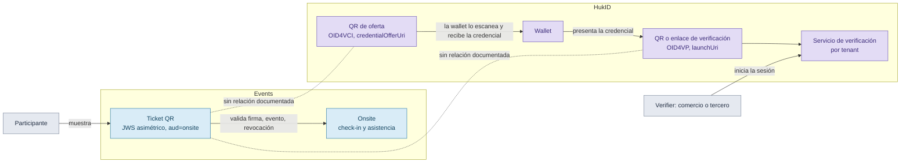
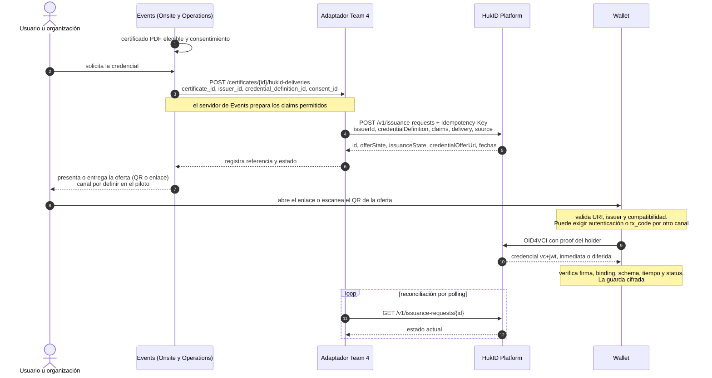
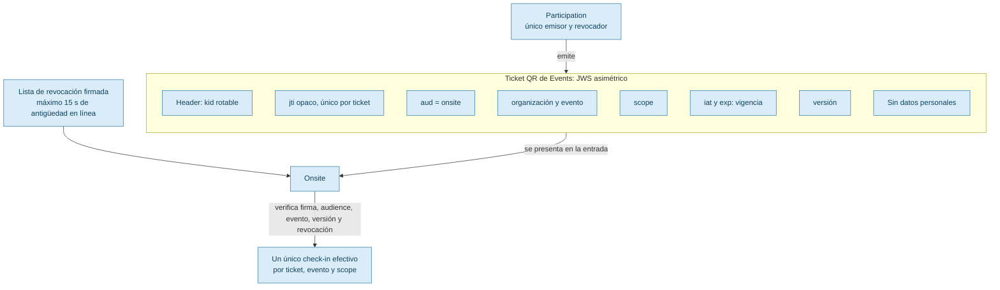

# Events y HukID: del certificado a la credencial

Estado: diagramas de lectura, fechados el **2026-11-17**. Resumen visual de lo que ya documentan [api-contracts](api-contracts.md) (frontera Events→HukID), [ux-flows](ux-flows.md), [arquitectura](architecture.md), [events-integration](contracts/events-integration.md) y [events-architecture-spine](events-architecture-spine.md) (AD-11). No es contrato normativo ni prueba que el adaptador o la emisión estén implementados: el código de Events no está en este repositorio y la emisión HukID tampoco. Si difieren, mandan los documentos enlazados. Events y HukID siguen siendo productos independientes.

Para el resumen en una página de qué hace cada actor y cuáles son los dos momentos (recibir y demostrar), ver [Qué construimos](credential-verification-architecture.md#qué-construimos-en-una-página).

Leyenda de color: azul, Events; violeta, HukID; gris, actor externo.

## 1. Tres QR distintos

Cada QR nace en un sistema, usa otro protocolo y cumple otro propósito. Solo el segundo y el tercero pertenecen a HukID. La documentación no relaciona el ticket de Events con los otros dos.

## 2. Del certificado a la credencial

El adaptador del Equipo 4 traduce entre los dos contratos. HukID no consume el bus de Events ni comparte su base de datos. La reconciliación v0 es por polling; los webhooks son evolución posterior.

## 3. Qué contiene el ticket QR de Events

Es un JWS firmado con una clave asimétrica. No lleva datos personales y su audiencia es solo el servicio de check-in ([events-integration](contracts/events-integration.md), sección Ticket y caché).

## Qué es de cada lado y qué falta

| Tema | Dueño | Estado |
| --- | --- | --- |
| Certificado PDF y consentimiento | Events | Operativo en su producto. |
| Adaptador Events a HukID | Events, Team 4 | Documentado como contrato; no está en este repo. |
| Solicitud de emisión y QR de oferta | HukID, Team 5 | Documentado; la emisión no está implementada en este repo. |
| Wallet | HukID, Team 5 | Flutter; no forma parte de este repo. |
| Servicio de verificación | HukID | Implementado en laboratorio; sin montar en producción. Ver la [arquitectura](credential-verification-architecture.md). |
| Credential definition de participación y claims mínimos | Por definir | Pendiente en [documentation-gaps](../05-delivery/documentation-gaps.md). Los ejemplos fiscales son ilustrativos. |
| Canal de entrega de la oferta y app no instalada | Por definir | Se decide en el piloto. |
| Autenticación del destinatario | Por definir | Necesaria para credenciales nominativas: escanear un QR no prueba identidad ([seguridad](../04-engineering/security.md)). |
| Uso del ticket QR como entrada del verifier | No documentado | Sería una decisión nueva: el ticket no es una presentación OpenID4VP. |

`organization_id` de Events y `tenant_id` de HukID no son equivalentes. El adaptador resuelve el vínculo autorizado entre ambos ([data-model](data-model.md)).
