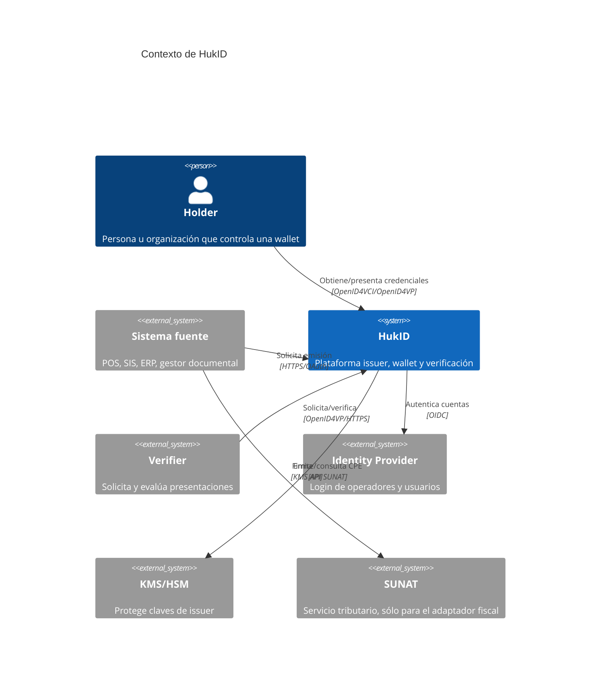
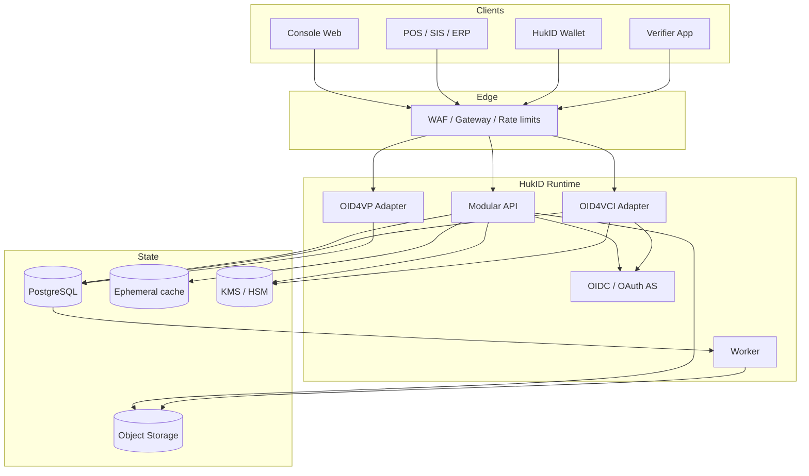
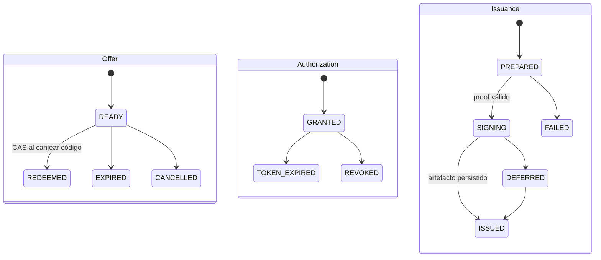
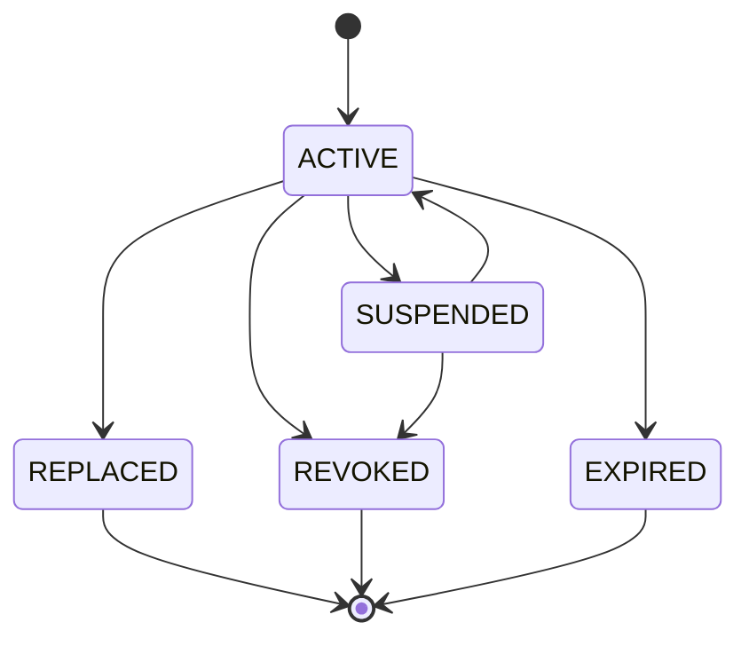

# 02 — Arquitectura de solución

## 1. Drivers arquitectónicos

1. Integrar dominios heterogéneos sin modificar el núcleo.
2. Entregar credenciales a wallets interoperables.
3. Aislar organizaciones, issuers, configuraciones y claves.
4. Evitar duplicados ante reintentos y redes inestables.
5. Mantener trazabilidad sin centralizar más PII de la necesaria.
6. Evolucionar formatos y estándares sin reescribir el producto.
7. Comenzar con un equipo pequeño y una operación sostenible.

## 2. Contexto C4



La dependencia SUNAT pertenece al POS o a un adaptador fiscal. El issuer core recibe evidencia normalizada; no debe convertirse en cliente tributario universal.

## 3. Vista de contenedores

El diagrama interactivo está en `hukid-platform.architecture.html` (artefacto no incluido; ver [registro de pendientes](../05-delivery/documentation-gaps.md)).



### 3.1 Borde de API

Responsabilidades: TLS, límites de tamaño, WAF, rate limit por client/tenant/IP, correlation id, validación básica de tokens y routing. No contiene reglas de negocio ni confía en un `tenantId` enviado por el body.

### 3.2 IAM

Tres planos independientes:

- **Operadores:** Authorization Code + PKCE, MFA y roles en console.
- **Sistemas:** Client Credentials, secreto rotado o `private_key_jwt`, scopes mínimos.
- **Wallet/holder:** autorización OID4VCI/OID4VP y prueba de posesión. Un access token de integración nunca actúa como holder.

### 3.3 Tenant & Issuer Registry

Administra tenants, membresías, issuers, dominios, estado de onboarding, referencias a claves y trust metadata. Un tenant puede operar varias razones sociales o instituciones, cada una como issuer independiente.

### 3.4 Definition Registry

Mantiene drafts mutables y versiones publicadas inmutables. Compila una definición a:

- validator de input;
- mapper de claims;
- configuración publicada OID4VCI;
- schema/context público;
- renderer metadata;
- reglas de vigencia/status/retención.

No se recomienda ejecutar código arbitrario de clientes. En el MVP, mappings declarativos y transformaciones permitidas.

### 3.5 Issuance Orchestrator

Valida autorización, definition, input, idempotencia y policy. Crea el snapshot de emisión, la oferta y el outbox. El snapshot guarda la versión exacta; nunca vuelve a evaluar una emisión histórica con la definición corriente.

### 3.6 OID4VCI Provider

Publica metadata, resuelve ofertas, maneja autorización/token/nonce y entrega credenciales. Consume casos de uso internos; no escribe tablas directamente. La emisión puede responder inmediatamente sólo cuando el artefacto ya está persistido; en cualquier ambigüedad usa la respuesta diferida normativa.

### 3.7 Signing Service

Construye el payload canónico del perfil, selecciona la clave activa del issuer, pide firma al KMS y devuelve un artefacto. Aplica allowlist de algoritmos. La API nunca acepta un `keyId` arbitrario del sistema fuente.

### 3.8 Status Service

Asigna índices y publica listas con caché/CDN. Actualizar status es una acción autorizada y auditada; la consulta pública no revela quién consulta ni enumera titulares.

### 3.9 OID4VP / Verification

El modo primario es wallet ↔ verifier externo: HukID no recibe la presentación. Como producto opcional, Verifier-as-a-Service construye requests, valida response binding, firma, tiempo, holder proof, status, schema y trust policy y devuelve un reporte estructurado. El verifier conserva la decisión final; el servicio no persiste `vp_token` ni claims por defecto.

### 3.10 Audit y Outbox

Cada mutación de seguridad genera un evento: actor, tenant, issuer, acción, aggregate, resultado, timestamp y correlation id. Se registran hashes o referencias, no credenciales completas. El outbox garantiza entrega eventual sin dual write.

## 4. Arquitectura interna

```mermaid
flowchart LR
  subgraph Driving[Adaptadores de entrada]
    REST[Private REST]
    VCI[OID4VCI]
    VP[OID4VP]
    Jobs[Workers]
  end
  subgraph Application[Aplicación]
    Commands[Commands]
    Queries[Queries]
    Policies[Authorization policies]
  end
  subgraph Domain[Dominio]
    Tenant[Tenant/Issuer]
    Definition[Credential Definition]
    Issuance[Issuance/Offer]
    Credential[Credential/Status]
    Verification[Verification Result]
  end
  subgraph Driven[Puertos de salida]
    Repos[Repositories]
    Signer[Signer Port]
    Events[Event Publisher]
    Clock[Clock/Entropy]
  end
  Driving --> Application --> Domain --> Driven
```



Regla de dependencias: sólo hacia dentro. DTOs OpenID y modelos PostgreSQL no ingresan al dominio.

## 5. Modelo multi-tenant

### 5.1 Jerarquía

```text
Tenant (contrato y administración)
├── Memberships / roles
├── Issuer A (identidad y claves)
│   ├── Credential definitions
│   └── Credential configurations
├── Issuer B
└── Integration clients
    └── grants: issuer + definition + environment
```

### 5.2 Aislamiento

- `tenant_id` obligatorio en cada fila tenant-scoped.
- Tenant resuelto desde credencial autenticada, nunca confiado desde body/header libre.
- Repository exige un `TenantContext`; no expone métodos globales al código normal.
- Row Level Security de PostgreSQL como defensa adicional, no como única defensa.
- Unique constraints incluyen `tenant_id` cuando el namespace sea tenant-local.
- La autorización server-side resuelve `(tenant, issuer, key_version)` a una key exclusiva y una policy IAM/KMS; un contexto específico del proveedor es sólo defensa adicional.
- Si se activa RLS: `SET LOCAL` dentro de cada transacción, runtime sin ownership ni `BYPASSRLS`, `FORCE ROW LEVEL SECURITY` y tests con pool/reuse.
- Métricas de negocio etiquetan tenant con ID opaco; nunca RUC/nombre.

Consultas administrativas cross-tenant viven en un plano separado, con break-glass, justificación y auditoría.

## 6. Entidades y ownership

| Entidad | Fuente de verdad | Datos clave |
| --- | --- | --- |
| Tenant | PostgreSQL | estado, plan, policy, residencia |
| Issuer | PostgreSQL + KMS ref | nombre legal, identifier, domains, keys |
| IntegrationClient | IAM + PostgreSQL | scopes, issuer grants, rotation |
| CredentialDefinition | PostgreSQL | slug, owner, lifecycle |
| DefinitionVersion | PostgreSQL/object store | snapshot, hash, schema, profile |
| IssuanceRequest | PostgreSQL | idempotency, snapshot, state, expiry |
| CredentialOffer | PostgreSQL | token hash, grants, consumed_at |
| IssuedCredentialMetadata | PostgreSQL | credential id/hash, issuer, version, dates |
| StatusEntry | PostgreSQL/status artifact | list id, index, purpose, state |
| AuditEvent | PostgreSQL transaccional + export append-only | actor, action, target, outcome |
| WalletCredential | dispositivo del holder | VC cifrada y metadata local |

## 7. Estado y transacciones

### 7.1 Oferta, autorización y emisión



Cada agregado usa compare-and-set/version column. Offer redimida no se vuelve a canjear; un token válido puede reintentar Credential Endpoint sin duplicar emisión.

### 7.2 Coreografía durable de firma

KMS y PostgreSQL no comparten transacción. El contrato es:

1. Transacción DB reserva `credential_id`, status slots, definition snapshot, holder key, payload final exacto, `key_version` y `signing_attempt_id`.
2. KMS firma fuera de la transacción usando ese input inmutable.
3. CAS persiste el artefacto exacto cifrado y su digest; si otro intento ganó, se devuelve el artefacto persistido.
4. Firma huérfana no entregada se registra para reconciliación; nunca se publica como segunda credencial.
5. Credential Endpoint sólo devuelve `credentials` cuando el artefacto está confirmado; de lo contrario retorna `transaction_id` e `interval`.
6. Status mantiene `desired_status` y `published_status`; la API no anuncia efectividad pública antes del artefacto publicado.

### 7.3 Credencial



`EXPIRED` se deriva de tiempo y puede no requerir escribir status. `REPLACED` enlaza `superseded_by` y no borra historia.

## 8. Datos y privacidad

### 8.1 Snapshot de claims

La emisión debe ser verificable, reentregable y reconciliable. Un hash no reconstruye una credencial y una firma puede no ser byte-determinista. Conservar según policy el artefacto emitido cifrado o los bytes finales exactos más firma, además de:

- hash del payload emitido;
- definition version;
- evidencia fuente o referencia con hash;
- issuer y key version;
- status index;
- timestamps;
- motivo/actor de cambios.

Guardar claims completos sólo si el producto o regulación lo exige, con cifrado por campo/tenant, retención y acceso auditado.

### 8.2 Comprobante electrónico

Claims mínimos sugeridos: tipo, serie/número, fecha, moneda, total, RUC del emisor, digest del XML, estado observado. Buyer identity y detalle de productos quedan fuera por defecto.

## 9. Despliegue

### 9.1 Ambientes

| Ambiente | Datos | Claves | Integraciones |
| --- | --- | --- | --- |
| local | sintéticos | software efímero | mocks |
| dev | sintéticos | KMS dev | sandbox |
| staging/conformance | anonimizados/sintéticos | KMS aislado | wallets/verifiers test |
| production | reales mínimos | KMS/HSM prod | endpoints prod |

Nunca compartir issuer identifiers, DB, buckets, client secrets ni key rings entre producción y no producción.

### 9.2 Topología inicial

- API stateless con 2+ réplicas en producción.
- Worker escalable de forma independiente.
- PostgreSQL gestionado con PITR.
- Object storage versionado y cifrado.
- KMS/HSM con políticas por servicio y separación de roles.
- CDN para metadata, schemas, contexts y status lists públicos.
- Secret manager; ningún secreto en imagen o repositorio.
- OpenTelemetry para logs, métricas y traces.

No introducir Kafka/Kubernetes por defecto. Una cola gestionada o outbox poller y una plataforma de contenedores simple son suficientes hasta que exista una razón medible.

## 10. Disponibilidad y degradación

| Dependencia caída | Comportamiento |
| --- | --- |
| KMS | No emitir; no hacer fallback a clave local; reintentar de forma acotada. |
| DB | Rechazar mutaciones; metadata/status cacheados pueden seguir sirviéndose si son seguros. |
| Object storage | Emisión que requiere evidencia queda diferida/falla recuperablemente. |
| IdP | Integraciones con tokens válidos pueden continuar según policy; logins nuevos no. |
| Status publisher | No declarar update completado hasta publicar; verification aplica freshness policy. |
| Sistema fuente | Emisiones ya preparadas continúan; HukID no reconstruye evidencia inventada. |

## 11. Evolución a servicios

Extraer sólo cuando aparezca una de estas señales:

- Signing requiere red/operación aislada certificada.
- Status traffic supera ampliamente emisión.
- Verification necesita escalar o desplegarse separado.
- Equipos distintos requieren autonomía real.
- Regulación exige boundary de datos.

Antes de extraer, el módulo ya debe poseer sus tablas lógicas, puertos, eventos y contrato. No compartir escrituras a tablas después de la extracción.

## 12. Perfil MVP fijado y decisiones no cerradas

Para el MVP, HukID opera un **issuer administrado por organización**. Cada issuer usa URL HTTPS estable `https://issuer.hukid.pe/{slug}`, key ring exclusivo en KMS y JWKS versionado bajo ese dominio. Custom domains, self-hosted y claves controladas por el cliente quedan fuera del MVP pero detrás de puertos `IdentifierResolver`, `MetadataPublisher`, `Signer` y `TrustRegistry`.

1. ¿Qué datos de comprobante tiene valor suficiente para justificar su presencia en la VC?
2. ¿Qué trust framework permitirá a terceros reconocer issuers?
3. ¿Wallet estrictamente local o sincronización cifrada multi-dispositivo?
4. ¿Quién asume soporte y reemisión tras pérdida del dispositivo?
5. ¿Qué freshness/SLA necesita cada status purpose y tipo?


## Lectura del alcance vigente

Las preguntas generales de la sección 12 se interpretan junto con el [perfil v0.1-draft](hukid-profile.md): wallet local-only por defecto e issuer-reauth como alternativa; account-linked y sincronización multidispositivo fuera de v0. Ver [alcance](../01-product/scope.md) para distinguir el MVP Events del roadmap completo de HukID.
