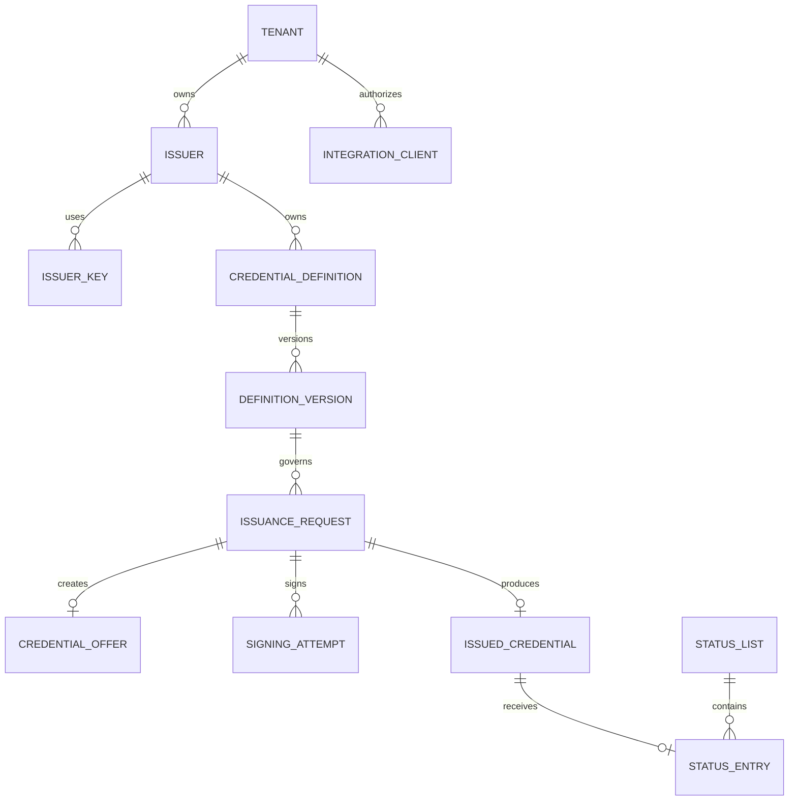

# 09 — Modelo de datos PostgreSQL

El DDL se encuentra en `database/001_initial.sql` (artefacto no incluido; ver [registro de pendientes](../05-delivery/documentation-gaps.md)) y `database/002_integrity_rls_and_concurrency.sql` (artefacto no incluido; ver [registro de pendientes](../05-delivery/documentation-gaps.md)). Este modelo pertenece al backend issuer; la wallet mantiene una base local independiente y cifrada.

AUTH-T03 incorpora [DDL nuevo de consola](console-persistence.md), limitado a identidad/membership/sesión y referencias audit/outbox. Se probó en PostgreSQL descartable; no recupera ni sustituye los archivos históricos de este modelo ni implementa los módulos issuer.

## Ownership

| Schema | Owner | Contenido |
|---|---|---|
| `tenancy` | Tenancy | tenants, memberships, issuers, claves referenciadas y clients |
| `definition` | Definitions | credential definitions y versiones inmutables |
| `issuance` | Issuance | requests, offers, signing attempts y artefactos emitidos |
| `status` | Status | listas, índices y estado deseado/publicado |
| `integration` | Integrations | webhooks y entregas |
| `platform` | Platform | idempotencia, outbox y auditoría |

## Relaciones centrales

## Invariantes en base

- `organization/tenant`, `issuer` e `integration_client` siempre se conservan como identidades distintas.
- Una definition publicada no se actualiza; una modificación crea `definition_version` nueva.
- Las foreign keys compuestas demuestran que client, issuer, definition version, key, status list y credencial pertenecen a la misma cadena de ownership.
- Idempotencia se acota por integration client y key; request hash diferente devuelve conflicto.
- La identidad externa es `(issuer, source_system, external_reference)` para que dos sistemas origen puedan reutilizar referencias sin colisionar.
- Offer almacena hash del código, nunca el código recuperable.
- El canje de una offer bloquea la fila y cambia `ready → redeemed` una sola vez; expiración, lockout y reintentos forman parte del mismo control.
- Payload final, key version y status slot se reservan antes de pedir firma a KMS.
- Claims y payload canónico se guardan cifrados con hash y versión de clave; el plaintext no se persiste en PostgreSQL.
- El envelope usa AES-256-GCM con tag unido al ciphertext, nonce aleatorio de 96 bits en columna separada y AAD canónico de tenant/issuer/agregado/campo; `delete_after` y `legal_hold` controlan crypto-shredding sin borrar hashes de evidencia.
- Un request produce como máximo una credencial activa.
- `desired_state` y `published_state` permiten reconciliar listas de status.
- Revocación es terminal; cambios de status usan `version` como CAS y purpose/list/slot quedan unidos por foreign keys compuestas.
- La credencial completa sólo se persiste cuando una política de evidencia lo exige; por defecto se guarda hash, metadata y object key cifrado.
- Outbox y audit se escriben en la misma transacción del cambio de dominio.

## Separación con wallet

PostgreSQL del backend no contiene:

- clave privada del holder;
- PIN/biometría;
- catálogo completo de credenciales del usuario;
- historial de presentaciones directas a terceros;
- secretos para descifrar un futuro backup end-to-end.

Puede contener:

- thumbprint público usado para holder binding;
- metadata mínima de credencial emitida;
- evidencia de consentimiento cuando HukID participó en el flujo;
- estado y revocación;
- eventos de seguridad y auditoría.

## Migraciones

- Archivos `NNNN_descripcion.sql`, forward-only y checksum.
- Definiciones publicadas no se reescriben durante backfills.
- Cambios de payload/schema requieren profile o definition version, no sólo migración de DB.
- Rotaciones de claves agregan versiones; claves públicas retiradas permanecen resolubles mientras existan credenciales válidas.
- Operaciones sobre tablas grandes usan expand/migrate/contract.
- Toda migración de seguridad valida RLS, grants y ausencia de acceso del rol de aplicación a material secreto.
- Los roles runtime son `NOBYPASSRLS`, no son propietarios de tablas y ejecutan `SET LOCAL app.tenant_id` en cada transacción.
