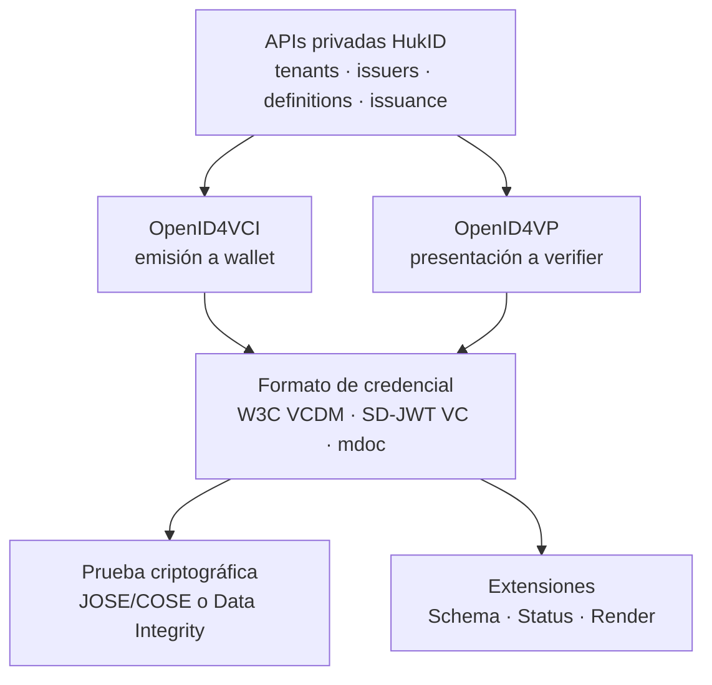
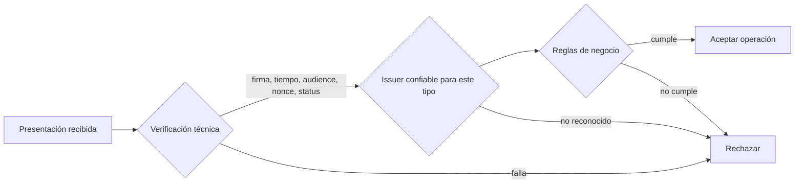

# 01 — Estándares y modelo conceptual

## 1. La respuesta corta a “¿primero necesito un schema?”

Necesitas primero una **definición de credencial de HukID**, no necesariamente un JSON Schema W3C.

La definición interna debe establecer:

- identidad y versión del tipo de credencial;
- issuer autorizado;
- claims requeridos, opcionales y sensibles;
- mapeo desde el sistema fuente;
- reglas de validación;
- formato criptográfico y algoritmo;
- política de binding con la wallet;
- vigencia y estado;
- presentación visual;
- política de retención y minimización;
- `credential_configuration_id` publicado por OpenID4VCI;
- `credentialSchema` y `@context`, si se usan.

Después de publicar esa versión, HukID puede crear ofertas. Esto impide que una integración emita payloads improvisados que luego ninguna wallet o verifier interprete igual.

## 2. Las cuatro capas



### 2.1 W3C VC Data Model 2.0

Define roles y estructura conceptual: issuer, holder, verifier, subject, claims, credential, presentation, períodos de validez, estado y mecanismos de prueba. Permite que aplicaciones definan propiedades específicas de un comprobante, título o licencia.

No define:

- login de la consola;
- alta de empresas;
- multitenancy;
- cobros y planes;
- cómo el POS solicita una emisión;
- OAuth entre POS y HukID;
- reglas por las que un verifier acepta a un issuer;
- la decisión comercial posterior a la verificación.

El overview W3C es deliberadamente no normativo: funciona como mapa de la familia de estándares. El documento local adjunto es v1.1; el contrato implementable sigue estando en las especificaciones normativas que referencia.

### 2.2 OpenID4VCI 1.0

Define cómo una wallet obtiene credenciales desde un Credential Issuer usando mecanismos OAuth 2.0. Entre otros elementos define:

- metadata del issuer;
- Credential Offer;
- `credential_configuration_ids`;
- Authorization Code Flow y Pre-Authorized Code Flow;
- token, nonce, proof of possession;
- Credential Endpoint;
- emisión diferida;
- respuesta y errores interoperables.

Para el ticket impreso, el Pre-Authorized Code Flow encaja porque el POS ya completó la transacción fuera del flujo OAuth. La wallet no debe asumir que quien escanea es el comprador legítimo: para documentos sensibles se añade `tx_code`, autenticación del usuario o entrega por canal autenticado.

### 2.3 OpenID4VP 1.0

Define cómo un verifier solicita y recibe una presentación. No obliga a aceptar el resultado: después de verificar criptografía, status y restricciones, el verifier evalúa su política de confianza y sus reglas de negocio.

### 2.4 W3C VC Lifecycle Management

El overview actualizado referencia APIs para gestión del ciclo de vida entre componentes de issuer, holder y verifier. Es un modelo útil, pero no sustituye automáticamente OpenID4VCI/VP. HukID adopta OpenID4VCI/VP como frontera interoperable inicial y mantiene sus APIs administrativas como producto propio.

## 3. Cinco artefactos que no son equivalentes

| Artefacto | Dueño | Función | Ejemplo |
| --- | --- | --- | --- |
| Credential Definition | HukID | Contrato interno, versionado y gobernado | `cpe-receipt@1.0.0` |
| Definition Version | HukID | Snapshot inmutable de claims y políticas | UUID de versión publicada |
| Credential Configuration | OpenID4VCI | Capacidad que el issuer anuncia a wallets | `pe.cpe.receipt.vc-jwt.v1` |
| `credentialSchema` | W3C VC | Referencia opcional para comprobar estructura | URL a JSON Schema versionado |
| `@context` | JSON-LD/W3C | Define los términos del documento VCDM 2.0 | contexto base más contexto HukID versionado |

Reglas:

- `@context` no sustituye validación.
- JSON Schema no firma ni demuestra quién emitió.
- Una Credential Configuration no es una credencial emitida.
- Una oferta no contiene necesariamente claims y nunca debe considerarse la credencial.
- Publicar una nueva versión no modifica credenciales históricas.

## 4. Roles de dominio HukID

| Rol | Significado en HukID |
| --- | --- |
| Tenant | Cliente contractual y límite de administración/facturación. |
| Issuer | Entidad que hace la afirmación y cuya clave firma. Puede haber varios por tenant. |
| Integration Client | Sistema autorizado —POS, ERP, SIS— que solicita emisiones para un issuer. |
| Subject | Entidad sobre la que se hacen claims; no siempre es la persona que porta la wallet. |
| Holder | Entidad que controla la credencial en una wallet y genera la presentación. |
| Wallet | Software/agente del holder. No debe confundirse con la cuenta web de HukID. |
| Verifier | Entidad que pide y evalúa una presentación. |
| Trust Registry/Policy | Fuente o reglas para decidir qué issuer es reconocido para qué tipo. |

Ejemplos donde holder y subject difieren:

- una empresa guarda una credencial sobre una factura;
- el padre guarda un certificado de su hijo;
- un representante porta un documento de una organización;
- una credencial describe un producto o una transacción, no una persona.

No se debe forzar `credentialSubject.id` a ser el DID de la wallet en todos los casos. El binding del holder y la identidad del subject son decisiones independientes.

## 5. Modelo de definición de credencial

```json
{
  "definitionId": "cpe-receipt",
  "version": "1.0.0",
  "status": "published",
  "issuerId": "iss_acme_peru",
  "credentialConfigurationId": "pe.cpe.receipt.vc-jwt.v1",
  "format": "application/vc+jwt",
  "types": ["VerifiableCredential", "ElectronicReceiptCredential"],
  "subjectBinding": "required-holder-key",
  "schemaUri": "https://schemas.hukid.pe/cpe-receipt/1.0.0/schema.json",
    "contextUris": [
      "https://www.w3.org/ns/credentials/v2",
      "https://schemas.hukid.pe/contexts/cpe/v1"
    ],
  "statusPurposes": ["revocation", "suspension"],
  "validity": {"mode": "source-or-policy", "defaultDays": 3650},
  "claims": [
    {"path": "document.number", "type": "string", "required": true},
    {"path": "document.total", "type": "decimal-string", "required": true},
    {"path": "document.xmlDigest", "type": "string", "required": true},
    {"path": "buyer.documentNumber", "type": "string", "required": false, "sensitivity": "restricted"}
  ]
}
```

La definición publicada es inmutable. Para cambiar claims, algoritmo, vocabulario o semántica se crea una versión. Cambios de texto visual que no alteran interpretación pueden ser revisiones de display separadas.

## 6. Formato criptográfico recomendado

Para el primer vertical:

- Modelo lógico: W3C VC Data Model 2.0.
- Perfil HukID de intercambio OID4VCI/OID4VP: `application/vc+jwt`, usando el media type W3C como Credential Format Identifier de extensión.
- Algoritmo inicial: ES256, sujeto a compatibilidad de librerías, wallet y KMS.
- Holder proof: JWT proof con nonce, audience y clave de la wallet.
- Status: dos entradas Bitstring Status List cuando se habilitan revocación y suspensión; los índices se reservan antes de firmar.

Esta elección evita mezclar VCDM 2.0 con el formato legado `jwt_vc_json`, que las especificaciones OpenID 1.0 definen sobre VC Data Model 1.1. El costo es explícito: `application/vc+jwt` es un perfil HukID sobre los puntos de extensión OpenID, y una wallet externa debe anunciarlo para ser compatible. El JWS usa payload VCDM 2.0 directo, `typ=vc+jwt`, sin contenedor `vc`; el contexto HukID define los términos propios. No entrega selective disclosure. Para credenciales sensibles, evaluar `dc+sd-jwt` como otro perfil y versión, nunca como sustitución silenciosa.

## 7. Verificación versus validación



HukID puede ofrecer una librería/servicio que produzca un reporte técnico. La respuesta no debe ser sólo `valid: true`; debe separar:

- integridad criptográfica;
- vigencia temporal;
- estado;
- holder binding;
- conformidad con schema;
- reconocimiento del issuer;
- resultado de política;
- razones y evidencia.

## 8. Qué representa la credencial de factura

Recomendación: no duplicar todo el XML fiscal en la wallet. Emitir una credencial mínima que permita:

- identificar issuer y comprobante;
- mostrar fecha, moneda y total;
- ligar la VC al documento fiscal mediante digest;
- enlazar a una copia autorizada o evidencia fuente;
- comprobar autenticidad, vigencia y estado.

La VC no debe afirmar “SUNAT aprobó” salvo que exista evidencia verificable y una semántica jurídicamente correcta. El claim puede expresar el estado observado y su timestamp, por ejemplo `taxAuthorityStatus: accepted`, `statusObservedAt`, y un digest del CDR; el issuer de esa afirmación sigue siendo la entidad definida por HukID.

## 9. Compatibilidad fuera de HukID

“Estándar” no significa que cualquier wallet aceptará cualquier credencial. Para interoperabilidad real deben coincidir:

- protocolo y versión;
- formato de credencial;
- algoritmos y binding;
- método de resolución de claves;
- semántica y tipo;
- status mechanism;
- trust framework;
- política del verifier.

Por ello, el MVP debe probar al menos una wallet HukID y un verifier de referencia, y además ejecutar pruebas de conformidad contra implementaciones externas cuando sea viable.
