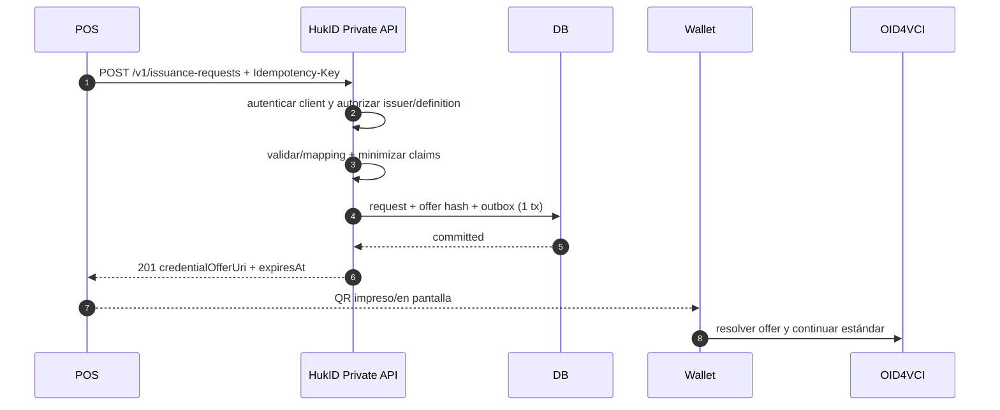
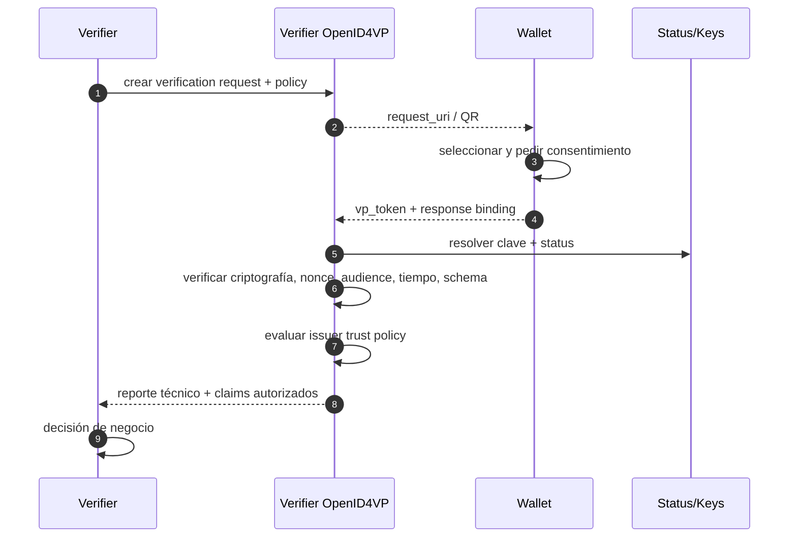

# 03 — Casos de uso y flujos

## Actores

- Administrador HukID
- Administrador de tenant
- Operador de issuer
- Sistema integrador
- Holder / wallet
- Verifier
- KMS/HSM
- Autoridad o fuente externa

## UC-01 — Onboard de tenant e issuer

**Precondición:** organización verificada por proceso comercial/KYB definido.

**Flujo principal:**

1. HukID crea tenant.
2. Invita administrador con MFA.
3. Administrador registra issuer legal y dominios.
4. HukID crea referencia de clave en KMS/HSM.
5. Se publica metadata del issuer.
6. Se crea integration client con grants limitados.
7. Evento de auditoría registra cada acción.

**Alternativas:** issuer suspendido; validación legal pendiente; custom domain no validado; key creation fallida.

**Postcondición:** issuer activo sin que ningún client pueda emitir hasta recibir grant sobre una definition publicada.

## UC-02 — Crear y publicar una Credential Definition

1. Operador crea draft `cpe-receipt`.
2. Define claims, sensibilidad, schema, context, formato, display, binding, status y vigencia.
3. Agrega mapping declarativo para el input canónico.
4. Sistema compila y valida ejemplos positivos/negativos.
5. Revisión de seguridad detecta claims innecesarios.
6. Operador publica versión inmutable.
7. HukID expone una Credential Configuration en issuer metadata.

**Invariante:** publicar no cambia versiones anteriores ni credenciales ya emitidas.

## UC-03 — POS solicita una oferta

Diagrama interactivo del ciclo completo: `credential-lifecycle.workflow.html` (artefacto no incluido; ver [registro de pendientes](../05-delivery/documentation-gaps.md)). Diagrama detallado POS → wallet: `pos-oid4vci.sequence.html` (artefacto no incluido; ver [registro de pendientes](../05-delivery/documentation-gaps.md)).

**Error/reintento:** si el POS no recibe respuesta, reenvía con la misma key y body. HukID devuelve el mismo `issuanceRequestId` y URI. Mismo key con body diferente retorna 409.

## UC-04 — Wallet obtiene la credencial

1. Wallet escanea o abre deep link.
2. Valida esquema URI y confirmación de dominio/issuer.
3. Recupera Credential Offer.
4. Descubre issuer y authorization server.
5. Comprueba que soporta configuration, format, algorithm y proof.
6. Canjea pre-authorized code; presenta `tx_code` si corresponde.
7. Recibe access token y nonce.
8. Genera holder proof con su clave.
9. Solicita credencial.
10. Issuer consume la oferta mediante CAS y crea el grant; esto no significa que ya emitió.
11. Issuer reserva issuance ID, status slots, payload/key version y signing attempt en DB; firma fuera de la transacción y persiste el artefacto exacto mediante CAS.
12. Si no puede confirmar el artefacto en tiempo, responde con emisión diferida normativa.
13. Wallet verifica antes de almacenar: issuer/kid, firma, nonce/binding, tiempos, schema y status inicial.
14. Wallet cifra y guarda localmente; muestra issuer, tipo y claims entendidos.

**Amenazas:** QR fotografiado, replay, phishing issuer, wallet maliciosa, token robado, proof replay. Controles: TTL, un uso, tx code para alto riesgo, issuer allowlist/UI, audience+nonce, DPoP si se adopta perfil, no logs.

## UC-05 — Emisión diferida

Se usa cuando la credencial requiere aprobación, consulta externa o firma que no termina dentro del timeout.

1. Credential Endpoint devuelve aceptación/transaction identifier según OID4VCI.
2. Wallet hace polling con backoff y límites.
3. Worker procesa y persiste resultado.
4. Endpoint entrega credencial cuando está lista.
5. Expiración, denegación y errores son terminales explícitos.

No inventar un `202` propietario dentro del endpoint estándar si el protocolo define su propia respuesta diferida.

## UC-06 — Certificado académico

Demuestra agnosticismo:

1. SIS llama al mismo endpoint privado usando definition `academic-certificate@1.0.0`.
2. El mapping convierte alumno, programa, grado y fecha al input canónico de `academic-certificate@1.0.0`.
3. La oferta y flujo wallet son iguales.
4. Cambian issuer, configuration, schema, context, display, vigencia, status y trust policy.

Si implementar el segundo vertical requiere condicionales `if source == POS` en el dominio, la arquitectura ha fallado.

## UC-07 — Presentar y verificar

Este es el modo directo e interoperable: HukID no media ni observa la presentación. Un cliente puede contratar Verifier-as-a-Service HukID como una implementación de `VP`; ese modo es opcional, tenant-scoped y no almacena `vp_token` ni claims por defecto.

**Salida mínima del verifier:** `cryptographic`, `temporal`, `status`, `holderBinding`, `schema`, `issuerTrust`, `policy`, `reasons`, `checkedAt`.

## UC-08 — Suspender, reactivar y revocar

- Suspender: reversible; requiere razón, actor y policy.
- Reactivar: sólo desde suspended, no desde revoked.
- Revocar: terminal; doble confirmación o permiso elevado para tipos críticos.
- Publicación de lista: update transaccional + outbox + publicación; registrar versión/digest.
- Verifier: aplica freshness máxima y fail-open/fail-closed según tipo. Para licencias, fail-closed puede ser necesario; para un recibo histórico quizá no.

## UC-09 — Reemplazar

1. Issuer marca intención de reemplazo.
2. Genera nueva issuance request con nueva definition version o claims corregidos.
3. Emite sucesora con enlace interno `replaces`.
4. Marca anterior como replaced/revoked según policy.
5. Wallet puede conservar ambas mostrando la sucesora.

Nunca mutar y volver a firmar “la misma” credencial ocultando la anterior.

## UC-10 — Pérdida o cambio de dispositivo

Cada definition declara una `reissuance_policy`:

- `local-only` — default: sin inventario cloud ni recovery; el holder vuelve al sistema fuente/issuer.
- `issuer-reauth` — alta assurance: el issuer vuelve a autenticar al sujeto y autoriza una nueva emisión.

En todos los casos, el nuevo dispositivo crea una clave nueva. Si se reemite, la anterior se reemplaza/revoca según policy. Una copia cifrada multi-dispositivo requiere otro threat model: key wrapping E2E, dispositivos autorizados, revocación y metadata correlacionable.

`account-linked` queda explícitamente fuera del perfil v0: no se habilita hasta definir assurance de vinculación, reautenticación, reemisión, revocación de dispositivos, metadata retenida y respuesta a account takeover. Una cuenta HukID no prueba identidad del subject.

## UC-11 — Borrar de la wallet

El holder puede borrar su copia. Esto no revoca el objeto del issuer ni elimina registros regulatorios. La UI debe explicar esa diferencia. El backend recibe telemetría sólo con consentimiento y sin inferir que “borrado” equivale a “revocado”.

## UC-12 — Rotación de clave del issuer

1. Crear nueva key version en KMS.
2. Publicar método/clave antes de uso.
3. Activar para nuevas firmas.
4. Mantener material público de claves anteriores durante la vida verificable de credenciales.
5. Retirar firma con clave vieja.
6. Destruir private key sólo según retention y capacidad de verificar artefactos históricos.

Compromiso de clave es otro runbook: suspender emisión, publicar incidente/status apropiado, rotar y evaluar reemisión masiva.

## Matriz de riesgo del mecanismo de entrega

| Documento | QR abierto | QR + tx code | Usuario autenticado | Aprobación issuer |
| --- | ---: | ---: | ---: | ---: |
| Recibo anónimo de bajo valor | posible | opcional | no | no |
| Factura con identidad del comprador | no recomendado | mínimo | recomendado | no |
| Certificado académico | no | opcional | sí | normalmente preaprobado |
| Licencia/credencial regulada | no | adicional | sí + assurance | sí/policy |

## Pruebas de aceptación transversales

- Dos tenants nunca acceden al mismo aggregate aunque adivinen ID.
- Un integration client no emite con un issuer/configuration no concedido.
- Reintento exacto no duplica; key reutilizada con otro hash falla.
- Oferta expirada/consumida no se canjea.
- Proof con nonce o audience incorrectos falla.
- Key version del issuer queda registrada.
- Definition histórica sigue validando con su snapshot.
- Revoked nunca vuelve a active.
- Logs no contienen tokens, códigos, VC completa ni claims restringidos.
- POS y SIS recorren el mismo caso de uso central.
