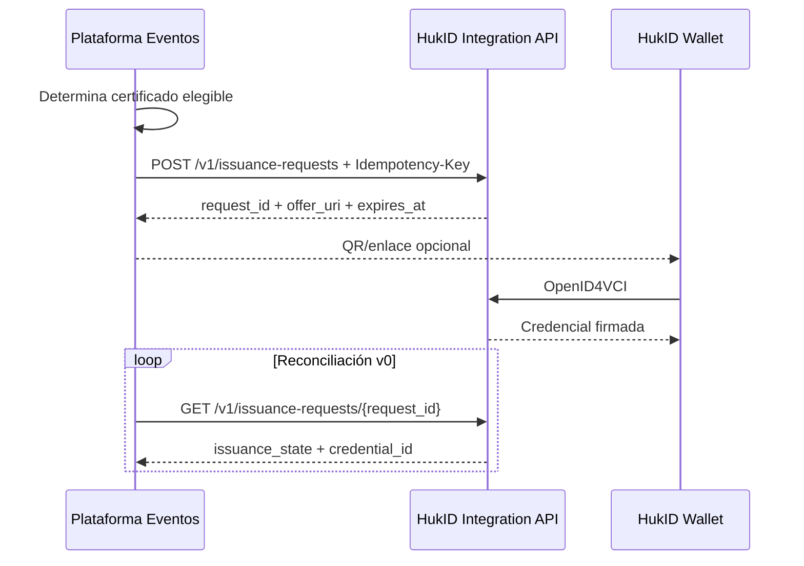

# 10 — Wallet, backend y nodos

## Decisión

HukID son dos productos ejecutables principales y varias superficies de protocolo:

1. **HukID Platform (Go):** issuer administrado, API de integración, OID4VCI, status, verificación opcional y consola futura.
2. **HukID Wallet (Flutter):** aplicación del holder, claves, credenciales locales, consentimiento y presentación.

No es correcto decir que toda la lógica vive en la wallet. La división correcta es por autoridad:

| Autoridad | Owner |
|---|---|
| Qué organización puede emitir | Backend |
| Qué definition/version usa | Backend |
| Qué claims acepta y valida | Backend |
| Qué clave del issuer firma | Backend + KMS/HSM |
| Vigencia, suspensión y revocación | Backend |
| Claves del holder | Wallet |
| Qué credenciales conserva el holder | Wallet |
| Qué comparte y con quién | Wallet |
| Validación local de firma/status/schema | Wallet |
| Presentación OID4VP | Wallet ↔ verifier |

## Wallet Flutter

Módulos recomendados:

```text
lib/
  app/                    # navegación, DI, lifecycle
  identity/               # holder keys y device binding
  issuance/               # offer parsing, OID4VCI y proof
  credentials/            # repositorio local y categorización
  verification/           # firma, status, schema, trust display
  presentation/           # OID4VP, DCQL, consentimiento y response
  recovery/               # local-only e issuer reauth
  security/               # secure storage, biometría, lockout
  shared/
    crypto/
    network/
    storage/
```

Persistencia local:

- Base SQLite/SQLCipher o equivalente cifrada.
- La clave maestra se envuelve con Keychain/Keystore y acceso biométrico/PIN local.
- La clave privada del holder se genera y usa en Secure Enclave/StrongBox cuando esté disponible.
- Credencial, render metadata y estado cacheado se guardan localmente.
- Tokens OID4VCI/OID4VP son efímeros; no se registran en logs.
- El backend no recibe una copia en claro para “sincronizar”.

La wallet valida como mínimo:

1. Metadata del issuer y configuration soportada.
2. Firma y `kid` contra JWKS autorizado.
3. VCDM/schema/context según el perfil HukID.
4. `validFrom`/`validUntil`.
5. Status publicado.
6. Holder binding `cnf.jkt` cuando aplique.
7. Política visual de confianza: válido técnicamente no equivale a issuer confiable.

## Backend Go

Módulos recomendados:

```text
cmd/
  api/
  worker/
internal/
  tenancy/
  issuers/
  integrations/
  definitions/
  issuance/
  credentials/
  status/
  verification/
  audit/
  adapters/
    privateapi/
    oid4vci/
    oid4vp/
    postgres/
    kms/
    objectstore/
```

El backend nunca acepta del POS:

- un `issuer_id` fuera de los grants del client;
- un `key_id` arbitrario;
- un schema/context no publicado;
- una credencial ya firmada para registrarla como propia;
- el tenant como dato confiable del body.

## ¿Existe un nodo por negocio?

### MVP: no

Cada organización es un tenant con uno o más issuers lógicos dentro de HukID administrado:

```text
HukID Managed Platform
 ├─ Tenant Incuba UNAS
 │   └─ Issuer https://issuer.hukid.pe/incuba-unas
 ├─ Tenant Comercio A
 │   └─ Issuer https://issuer.hukid.pe/comercio-a
 └─ Tenant Universidad B
     └─ Issuer https://issuer.hukid.pe/universidad-b
```

Cada issuer tiene claves KMS, definitions, policies, status lists, scopes y auditoría aislados. Esto evita desplegar, actualizar, monitorear y certificar un servicio distinto por cliente.

### Futuro: HukID Issuer Node self-hosted

Sólo se justifica cuando una organización exige controlar infraestructura o claves. Ese nodo sería un producto de despliegue, no una bifurcación del protocolo.

Debe:

- implementar el mismo perfil HukID v0/vN;
- exponer metadata, JWKS, OID4VCI y status compatibles;
- usar sus propias claves/KMS y PostgreSQL;
- publicar auditoría y salud sin compartir su DB con HukID Cloud;
- poder recibir definitions empaquetadas y firmadas;
- pasar el mismo conformance suite.

No debe:

- conectarse directamente a la base de HukID administrado;
- usar credenciales privadas de otro tenant;
- inventar formatos incompatibles bajo el mismo profile/version;
- requerir blockchain para emitir o verificar.

## Integración con la plataforma de eventos

Los proyectos permanecen separados:



La plataforma de eventos conserva su certificado PDF y reglas de asistencia. Su worker llama a HukID; HukID no consume directamente el outbox de Events. HukID recibe un snapshot explícito de claims y evidencia, crea una oferta y administra la credencial. No existe FK ni transacción distribuida entre las dos bases; la llamada es idempotente y reconciliable por `(issuer, source.system, source.reference)`. En v0 la reconciliación final usa polling; webhooks son una optimización posterior.
