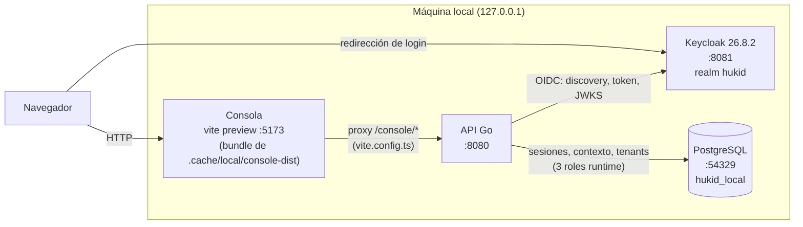
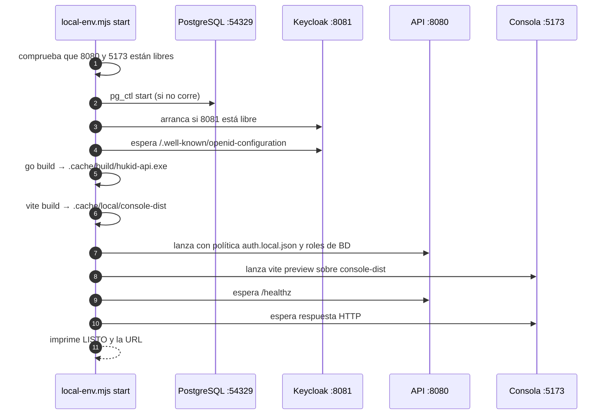
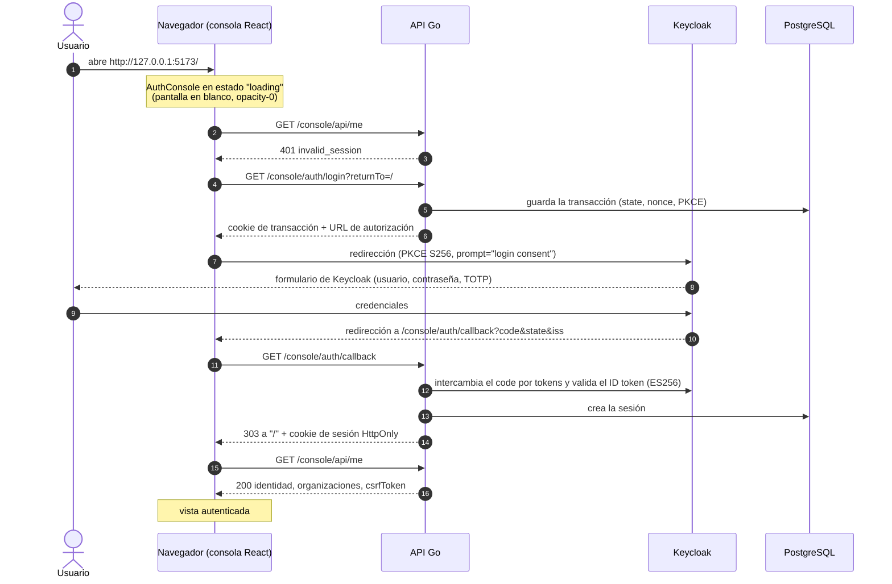

# Flujo global de HukID (entorno local)

Vista paso a paso de qué piezas existen, cómo arrancan y qué llama a qué durante el login. Los diagramas están en [Mermaid](https://mermaid.js.org/), que GitHub dibuja directamente.

Alcance: sólo el entorno local de `scripts/local-env.mjs`. No describe producción ni despliegue (sin decidir; ver [pendientes](../05-delivery/documentation-gaps.md)). Cada paso se contrastó con el código citado; lo no comprobado de extremo a extremo se marca como tal.

## 1. Piezas y conexiones (contenedores)

- El navegador sólo habla con la consola (`:5173`) y, durante el login, con Keycloak (`:8081`).
- Todo `/console/*` pasa por el proxy de Vite hacia la API sin reescribir `Origin`, para conservar cookies y CSRF (`src/console/vite.config.ts`).
- La API es el único cliente OIDC y el único que usa PostgreSQL.

## 2. Arranque: `node scripts/local-env.mjs start`

Fuente: `scripts/local-env.mjs` (función `start`). `init` y `keycloak-init` crean o actualizan el entorno; `bootstrap` requiere Keycloak activo y puede ejecutarse tras `start`, en otra terminal. El [perfil Keycloak](../03-design/console-local-keycloak.md) incluye verificación previa y configuración de miembros/dashboard.

## 3. Login: abrir la raíz sin sesión

Fuentes:

- Cliente: `src/console/src/authentication/AuthConsole.tsx` (`run('read')`, `claimAutoLogin`, `run('login')`) y `client.ts` (`/console/api/me`, `navigate`).
- API: `src/platform/internal/adapters/console/login.go` (`start`, `complete`, cookie de transacción con `Path=/console/auth`, `303` al terminar).
- OIDC: `src/platform/internal/adapters/oidc/client.go` (PKCE `S256`, `prompt=login consent`, firma ES256).
- Callback registrado: `src/platform/config/auth.local.json` (`redirectUri` a `:5173/console/auth/callback`).

### Reglas del arranque automático

- Si el primer `GET /console/api/me` devuelve 401, la consola inicia el login sola; no existe pantalla de acceso ([ADR-0025](../decisions/ADR-0025.md)).
- Un segundo intento automático en menos de 60 s no se hace: se muestra la vista "Acceso no completado" con el botón "Iniciar sesión de nuevo" (evita un bucle si el proveedor falla).
- Al cerrar sesión se repite el mismo ciclo y vuelve a pedirse usuario y contraseña, porque el login siempre fuerza credenciales.
- Configurar TOTP por primera vez no sustituye ejecutar el autenticador OTP: si el primer callback se rechaza, volver a HukID e iniciar sesión de nuevo con contraseña y OTP. No se crea sesión sin la evidencia requerida.

## 4. Evidencia y límites

- `npm run test:keycloak` comprueba el perfil real en recursos aislados; las [tareas AUTH](../features/FEAT-001-authentication/tasks.md) registran el resultado vigente y las limitaciones. La [auditoría inicial](../05-delivery/reviews/local-flow-2026-11-09.md) conserva las incompatibilidades originales.
- El orden exacto de las escrituras en PostgreSQL durante `start` y `complete`: el diagrama indica el efecto, no cada consulta.
- Producción: HTTPS, dominio, base de datos persistente y copias de seguridad de Keycloak.

Para contrastar el orden real de llamadas, revise `.cache/local/api.log` (API) y `.cache/local/console.log` (consola) mientras abre la raíz.
