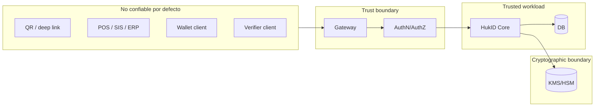

# 05 — Seguridad y operación

## 1. Objetivos de seguridad

- Sólo issuers autorizados firman con sus claves.
- Un client sólo emite configuraciones concedidas.
- Una oferta no puede reclamarse dos veces.
- La wallet prueba control de su clave cuando el perfil lo exige.
- Un verifier detecta alteración, expiración, revocación y replay.
- Ningún tenant observa datos de otro.
- Auditoría explica quién hizo qué sin convertirse en réplica de PII.
- La caída de KMS o status no induce un fallback inseguro.

## 2. Límites de confianza



“Trusted workload” no significa confiar en sus inputs; significa que está bajo control operacional. Toda entrada sigue validándose.

## 3. Amenazas y controles

| Amenaza | Control preventivo | Detección/recuperación |
| --- | --- | --- |
| QR fotografiado | TTL, un uso, tx code/auth para documentos sensibles | conteo de canjes fallidos, cancelar/reemitir |
| Replay de offer/token/proof | nonce, audience, expiry, atomic consume | audit + alert de reuse |
| Client comprometido | scopes y grants mínimos, private_key_jwt/mTLS, rotation | revoke client, anomaly detection |
| Confusión de tenant | tenant desde token, repository context, RLS | tests negativos, audit cross-tenant |
| Firma con issuer incorrecto | mapping issuer→key server-side, key exclusiva y policy IAM/KMS | key version en audit, reconciliation |
| Extracción de clave | KMS/HSM no exportable, least privilege | disable key, incident/reissue plan |
| Algorithm confusion | allowlist por profile, validar `alg`/`kid` | reject + telemetry |
| SSRF por schema/context | allowlist, fetcher aislado, cache, size/time limits | egress logs, circuit breaker |
| JSON-LD context malicioso/cambiante | URLs versionadas, digest/cache, no fetch dinámico en hot path | integrity alarm, pin snapshot |
| Status correlation | Bitstring aggregate, CDN, no endpoint por credential | privacy review y cache logs mínimos |
| Log leakage | redaction allowlist, payloads no loggeados | DLP scans y deletion procedure |
| Webhook spoof/replay | firma, timestamp window, event id | receiver dedup + secret rotation |
| Verifier phishing | trusted UI, display issuer/verifier, consent | report/block verifier |
| Wallet root/jailbreak | secure storage, risk signal, policy por assurance | revoke/reissue; no prometer hardware assurance inexistente |

## 4. Autorización

### 4.1 Clases de token y prevención de sustitución

Las superficies no comparten una política de aceptación genérica. Los tokens de operador usan `aud=https://api.hukid.pe/operator`; las integraciones client-credentials usan `aud=https://api.hukid.pe/integration`; los tokens de wallet OID4VCI usan como `aud` el issuer exacto. Todo access token JWT usa `typ=at+jwt` y `hukid_token_class` (`operator`, `integration` u `oid4vci`). Cada adapter valida issuer, firma, audience única, clase, grant y expiración antes de scopes o reglas de dominio. Un token válido en una clase se rechaza en las otras dos.

### 4.2 RBAC y atributos

Combinar RBAC y atributos:

- rol: tenant_admin, issuer_operator, security_admin, support_readonly;
- atributos: tenant, issuer, environment, credential definition, action;
- condiciones: issuer active, definition published, client grant valid, amount/risk thresholds;
- separación de funciones: crear issuer/key no equivale a aprobar producción;
- break-glass: duración corta, ticket/justificación, MFA y alerta.

Scopes sugeridos:

```text
tenant:read tenant:write
issuer:read issuer:write issuer:key-rotate
definition:read definition:draft definition:publish
issuance:create issuance:read issuance:cancel
credential:status verification:create audit:read
```

## 5. Gestión de claves

### 5.1 Issuer keys

- Clave asimétrica no exportable.
- Alias lógico y key version física.
- Política KMS permite `Sign`, no decrypt/export.
- Servicio de firma recibe payload hash/bytes y contexto, no secretos.
- Rotación programada y por incidente.
- Clave pública/método disponible mientras credenciales históricas se verifican.
- Inventario: owner, issuer, algorithm, created/activated/retired/compromised.

### 5.2 Holder keys

- Generadas en dispositivo; secure enclave/keystore cuando exista.
- Biometría es gate local, no identidad criptográfica por sí sola.
- Backup/export desactivado por defecto para perfiles de alto assurance.
- Recovery por reemisión; si se habilita sync, diseñar key wrapping end-to-end.

### 5.3 Service and client keys

Separadas de issuer keys. No firmar webhooks, access tokens y VCs con la misma clave.

## 6. Protección de datos

### 6.1 Clasificación

| Clase | Ejemplos | Tratamiento |
| --- | --- | --- |
| Público | issuer metadata, public keys, schemas | CDN, integrity, versionado |
| Interno | IDs operativos, métricas agregadas | acceso servicio/equipo |
| Confidencial | source refs, audit contextual | cifrado, retention limitada |
| Restringido | DNI, buyer identity, credential payload | minimización, field encryption, acceso auditado |
| Secreto | tokens, offer codes, private keys | no logs; hash/secret manager/KMS |

### 6.2 Retención

Configurable por credential type y obligación. La base debe registrar `retention_policy_id`, `delete_after` y legal hold. Borrado de wallet, eliminación de cuenta y retención del issuer son procesos distintos.

### 6.3 Consentimiento y UX

Antes de presentar, la wallet muestra verifier, propósito, claims solicitados, duración y si la operación permite selección. Evitar consent screens genéricas que inducen a compartir todo.

## 7. Auditoría

Evento mínimo:

```json
{
  "eventId": "aud_01K...",
  "occurredAt": "2026-10-10T01:32:10Z",
  "actor": {"type": "integration_client", "id": "cli_01K..."},
  "tenantId": "ten_01K...",
  "issuerId": "iss_01K...",
  "action": "credential.issue",
  "target": {"type": "issuance_request", "id": "ir_01K..."},
  "outcome": "success",
  "correlationId": "cor_01K...",
  "evidence": {"definitionVersion": "defv_01K...", "keyVersion": "kms:v7", "payloadDigest": "sha256-..."}
}
```

El ledger mínimo de auditoría se inserta en PostgreSQL dentro de la misma transacción que la mutación. Un outbox lo proyecta idempotentemente a un archivo append-only con controles de integridad, acceso separado y exportación. La caída del projector no pierde la evidencia transaccional. No afirmar “inmutable” sólo porque una tabla no tiene endpoint DELETE.

## 8. Observabilidad

### 8.1 Métricas

- requests y errores por surface/operation/status;
- issuance latency por fase;
- offers created/consumed/expired;
- duplicate idempotency hits/conflicts;
- signing latency/error por KMS key class, no por issuer legal name;
- deferred queue age;
- status publication lag;
- verification failures por reason category;
- webhook attempts/dead letters;
- tenant isolation denials.

### 8.2 Tracing

Correlation desde POS hasta outbox/webhook. No propagar token, claims ni pre-authorized code como baggage.

### 8.3 Alertas

- tasa anómala de emisión/client;
- canjes repetidos de ofertas;
- firma con key no activa;
- status publication lag sobre policy;
- failed login/MFA y grant changes;
- acceso break-glass;
- RLS/tenant-denied anomalies;
- backups o restore tests fallidos.

## 9. Objetivos no funcionales iniciales

Son objetivos de diseño, no SLA contractual:

| Indicador | Objetivo inicial |
| --- | --- |
| Disponibilidad Integration API | 99.9% mensual |
| Crear oferta p95 | < 500 ms sin dependencia externa |
| Credential Endpoint p95 | < 1 s para emisión inmediata, excluye UX/red |
| Metadata/status público | 99.95% con CDN |
| RPO PostgreSQL | ≤ 5 min |
| RTO | ≤ 60 min |
| Propagación de revocación | policy por tipo; objetivo base ≤ 5 min |

Antes de vender SLA: load test, failure injection, capacity model y costo. El RTO/RPO inicial no cubre pérdida regional irrecuperable del KMS hasta que un ADR y un ejercicio de DR definan replicación/escrow permitido, status signing keys, DNS/CDN y reconciliación criptográfica.

## 10. Backups y disaster recovery

- PITR y backup cifrado de DB.
- Object versioning y replicación acorde a RPO.
- Export de configuración KMS; private keys siguen política del proveedor/HSM.
- Restore test trimestral a ambiente aislado.
- Runbook que valida DB + object + status + public metadata juntos.
- No restaurar ofertas expiradas como canjeables.
- Después de restore, reconciliar outbox y webhooks idempotentemente.

## 11. Runbooks mínimos

1. KMS no disponible.
2. Compromiso de integration client.
3. Sospecha/compromiso de issuer key.
4. Fuga de QR/pre-authorized codes.
5. Status list corrupta o stale.
6. Cross-tenant access attempt.
7. Cola diferida acumulada.
8. Webhook dead-letter.
9. Restore y failover.
10. Eliminación/DSAR/legal hold.

Cada runbook define trigger, severidad, owner, contención, recuperación, evidencia, comunicación y postmortem.

## 12. Checklist de producción

- Threat model revisado.
- Algoritmos/perfiles con pruebas negativas.
- Tenant isolation tests automatizados.
- Key rotation ensayada.
- Secrets/redaction scan.
- Dependency/SBOM/vulnerability policy.
- Backups y restore probados.
- Rate limits/capacity definidos.
- Privacy impact assessment.
- Revisión legal Perú.
- Conformance/interoperability tests.
- Runbooks y on-call.
- Observabilidad sin PII.
