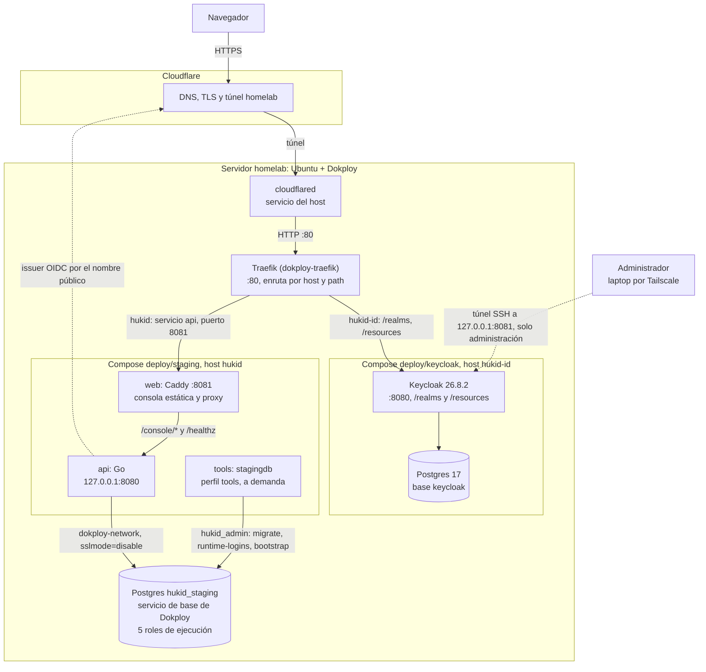

# Arquitectura de staging desplegada en Dokploy

Estado: descripción de lo que corre desde 2026-11-10; no autoriza producción. [ADR-0029](../decisions/ADR-0029.md) registra las decisiones y los límites hacia producción. Fuentes: [`deploy/keycloak/docker-compose.yml`](../../deploy/keycloak/docker-compose.yml), [`deploy/staging/compose.yaml`](../../deploy/staging/compose.yaml) y [`deploy/staging/Caddyfile`](../../deploy/staging/Caddyfile). No contiene secretos ni valores de entorno.

## Diagrama

Línea continua: tráfico de datos. Línea punteada: consulta de identidad o administración.

## Componentes

| Componente | Rol | Notas |
| --- | --- | --- |
| Cloudflare | DNS, TLS y túnel `homelab` | Las rutas `hukid-id` y `hukid` apuntan a `http://localhost:80`. |
| `cloudflared` | Cliente del túnel | Servicio del host (systemd), no un contenedor. |
| Traefik | Entrada HTTP del servidor | Contenedor `dokploy-traefik`, puerto 80 del host. |
| Keycloak | IdP OIDC, realm `hukid` | 26.8.2 con `start`. `KC_HOSTNAME` es la URL pública; la administración solo escucha en `127.0.0.1:8081` del host. |
| Postgres de Keycloak | Base `keycloak` | Volumen `keycloak-db-data`, red `default` del compose, sin puerto publicado. |
| `web` | Caddy: consola estática y proxy | Escucha en 8081 dentro del espacio de red de `api` (`network_mode: service:api`). Sin puertos publicados. |
| `api` | Backend Go | `127.0.0.1:8080`, `HUKID_ENV=staging`. Healthcheck con el subcomando `hukid-api healthcheck`. |
| `tools` | `stagingdb`: `migrate`, `runtime-logins`, `bootstrap` | Perfil `tools`: solo corre con `docker compose --profile tools run`. Usa el propietario `hukid_admin`. |
| Postgres `hukid_staging` | Base de HukID | Servicio de base de Dokploy `hukid-staging-db-ggfxdz:5432`, sin puerto externo. Cinco logins de ejecución con RLS ([ADR-0029](../decisions/ADR-0029.md), punto 3). |

## Rutas públicas

| Host | Path | Destino | Dónde se configura |
| --- | --- | --- | --- |
| `hukid-id.zentrycore.com` | `/realms`, `/resources` | Keycloak, puerto 8080 | Etiquetas de Traefik en `deploy/keycloak/docker-compose.yml`. |
| `hukid-id.zentrycore.com` | `/admin` y el resto | Sin ruta: 404 de Traefik | No se enruta a propósito. |
| `hukid.zentrycore.com` | Todos | Servicio `api`, puerto 8081, atendido por `web` | Pestaña Domains de Dokploy (no versionado). |

Dentro de `web`, `/console/*` y `/healthz` pasan a `api`; el resto sirve el build estático con `index.html` como respaldo.

## Límites de este diagrama

- Se dibujó a partir de los compose y de comprobaciones manuales del 2026-11-10 (discovery de Keycloak con 200, `/healthz` con 204 por Traefik, login de punta a punta). No se contrastó con una exportación de la configuración de Dokploy ni de Cloudflare.
- Viven fuera del repositorio y no están verificadas aquí: el dominio `hukid.zentrycore.com` de Dokploy, las rutas del túnel y la regla de caché de Cloudflare para `/realms/*`.
- Recrear `api` obliga a reiniciar `web`, por `network_mode: service:api` ([operación](staging-operations.md)).
- El realm `master` también responde por `/realms`; su restricción es una propuesta no aplicada ([keycloak-master-realm.md](keycloak-master-realm.md)).
- La verificación de punta a punta contra staging no está ejecutada ([staging-verification.md](staging-verification.md)).

Contexto: [ADR-0028](../decisions/ADR-0028.md) define el entorno `staging` del backend.

Volver al [índice del proyecto](../../README.md).
