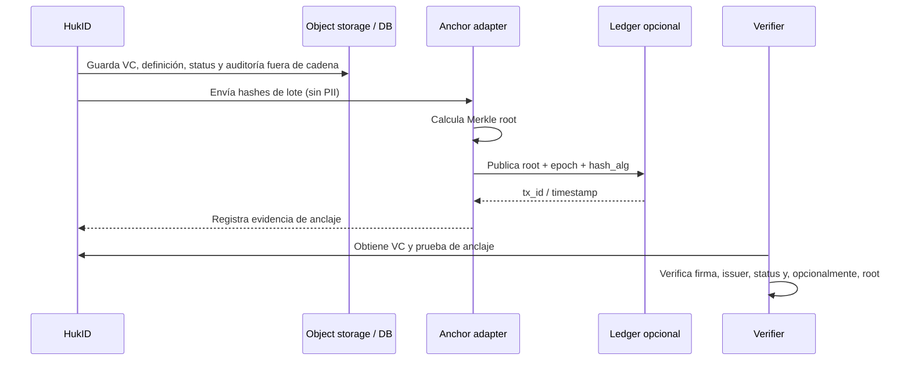

# Blockchain, registros de confianza y anclaje externo

## Decisión ejecutiva

HukID **no necesita blockchain para implementar credenciales verificables**. W3C VCDM 2.0 permite que el registro de datos verificables sea una base confiable, una base descentralizada, una base gubernamental o un registro distribuido; no prescribe una cadena. OpenID4VCI define un protocolo agnóstico al formato y tampoco exige ledger.

Por ello, la decisión para v0 es:

- la autenticidad proviene de la firma del issuer;
- la resolución de claves proviene de metadata/JWKS HTTPS;
- el estado proviene de Bitstring Status List;
- la auditoría operativa proviene de PostgreSQL, artefactos inmutables y outbox;
- blockchain queda como adaptador opcional de anclaje, no como dependencia del producto.

Esto no contradice que Hyperledger, Indy/Aries o GoPlausible puedan usar una red distribuida. Esas son elecciones de ecosistema y despliegue. Los estándares de VC y OpenID no obligan a adoptarlas.

## Qué problema resuelve cada mecanismo

| Necesidad | Mecanismo HukID v0 | ¿Blockchain necesaria? |
| --- | --- | --- |
| Probar quién emitió una credencial | JWS/COSE y clave pública del issuer | No |
| Validar que no fue alterada | Firma + validación del payload | No |
| Saber si fue suspendida/revocada | Bitstring Status List | No |
| Resolver la clave del issuer | HTTPS metadata/JWKS | No |
| Auditar qué hizo HukID | DB transaccional + outbox + logs | No |
| Probar existencia en una fecha ante terceros | Anclaje de hash/Merkle root | Opcional |
| Compartir un registro de confianza entre instituciones sin operador único | Ledger consorcial o público | A veces |

## Qué significa “anclar”

El anclaje no publica la credencial. HukID agrupa hashes de artefactos o eventos de un periodo, calcula una raíz Merkle y publica únicamente esa raíz y metadatos mínimos en una red elegida.



La cadena no sustituye la validación de firma, confianza o estado. Un verificador puede exigir anclaje sólo para tipos de credencial o procesos que lo necesiten.

## Límites de datos

**Fuera de cadena:** VC/VP, claims, factura, nombres, documentos, QR, tokens, logs detallados, claves privadas y cualquier identificador que permita correlación innecesaria.

**En cadena, como máximo:** `batch_id`, `merkle_root`, `hash_alg`, `created_at`, `chain_id`, `network`, `tx_id` y una referencia técnica no personal. La referencia al artefacto debe seguir siendo resoluble sin exponer PII.

## Cuándo sí tendría sentido

1. Varias instituciones independientes necesitan un registro común de emisores o definiciones y ninguna debe controlarlo por completo.
2. Se necesita una prueba pública y duradera de que una versión de definición, lista de estado o lote existía antes de una fecha.
3. Un socio o regulación específica exige una red concreta y el valor de interoperabilidad compensa el costo.

## Cuándo sería una mala decisión

- Escribir cada factura o credencial completa en una red pública.
- Usar la cadena como base de revocación por credencial.
- Bloquear la emisión si el nodo RPC, la red o el proveedor de anclaje está caído.
- Guardar secretos o claves privadas en contratos o transacciones.
- Elegir Algorand/Hyperledger antes de tener un requisito de confianza multi-organización medible.

## Roadmap recomendado

**v0:** ningún nodo ni wallet depende de blockchain. Implementar el contrato `AnchorProvider` detrás de un puerto, inicialmente con implementación `Noop`/`LocalAudit` para conservar la opción sin introducir costo operativo.

**v1 opcional:** anclaje por lotes de snapshots de definiciones, status lists o auditoría, con un proveedor intercambiable (por ejemplo Algorand). Hacerlo asíncrono, reintentable e idempotente.

**Antes de activarlo en producción:** demostrar quién verifica el anclaje, qué amenaza resuelve, qué datos mínimos se publican, cómo se rota el proveedor, cómo se prueba la continuidad si la red desaparece y qué requisito legal/comercial lo justifica.

## Contrato conceptual del adaptador

```json
{
  "batch_id": "bat_01J...",
  "hash_alg": "sha-256",
  "merkle_root": "base64url...",
  "artifact_count": 1200,
  "network": "algorand-mainnet",
  "chain_id": "...",
  "tx_id": "...",
  "anchored_at": "2026-10-10T15:00:00Z"
}
```

Este objeto es evidencia de operación de HukID; no es una credencial ni reemplaza el `issuer` o el `credentialStatus` de la VC.
